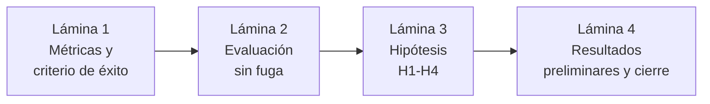

# Guía de Exposición: Bloque 4 — Evaluación, Hipótesis y Resultados Preliminares
**Curso:** Inteligencia Artificial (1INF24) — Tarea Académica  
**Proyecto:** Clasificación de la Pobreza Monetaria en Lima Metropolitana mediante Aprendizaje Supervisado sobre Microdatos de la ENAHO  
**Autores:** Gael Sebastian Arias Escalante, Melanie Nadine Mallqui Huaraz, Valeshka del Pilar Lavado Guerra, Edilvan Franco Salcedo Enciso  
**Expositor del bloque:** Edilvan Franco Salcedo Enciso  

---

## 📌 1. Objetivos y Dinámica de la Exposición

El bloque 4 cierra la exposición y dura **2 minutos**. Responde al **criterio 4 de la rúbrica (evaluación, 3 puntos)**: cómo se juzgará si la solución funciona, si el criterio es coherente con el problema y cómo se interpretan los resultados preliminares.

Debe dejar claros 4 puntos:
1. **Qué medimos y por qué:** PR-AUC y error de exclusión a cobertura fija $B = 20\%$, porque con 18.9% de hogares pobres la exactitud engaña.
2. **Cómo evitamos la fuga de información:** `GroupKFold` por conglomerado, prueba fuera de tiempo 2024 → 2025 sin los 930 hogares panel y *bootstrap* por conglomerados.
3. **Las 4 hipótesis** y cuándo se refuta cada una.
4. **Qué dicen los resultados preliminares** (solo 2024) y qué falta.

> ⚠️ **Regla de oro:** todas las cifras de este bloque provienen de la **validación agrupada de 2024**. La prueba en **2025**, CART, LightGBM y TreeSHAP **aún no se han ejecutado**: se presentan como plan, nunca como resultado (ver §4).

---

## 🎞️ 2. Estructura Lámina por Lámina (Slide-by-Slide)

---

### 🔹 LÁMINA 1: Métricas y Criterio de Éxito
* **Tiempo sugerido:** 25 segundos
* **Título de la diapositiva:** ¿Cómo sabremos si el modelo funciona?
* **Elementos visuales a incluir:**
  * Barra de proporciones: **81% no pobres / 19% pobres**, con la frase *"Decir 'nadie es pobre' acierta 81% y no ayuda a nadie"*.
  * Matriz de errores 2×2:

| | Predice pobre | Predice no pobre |
| :--- | :---: | :---: |
| **Hogar pobre** | Verdadero positivo (recibe ayuda) | **Error de exclusión** (queda sin ayuda) |
| **Hogar no pobre** | **Error de inclusión** (ayuda indebida) | Verdadero negativo |

  * Métricas principales:
    * **PR-AUC**: su línea base al azar es la prevalencia, ≈ 0.19.
    * **Error de exclusión** $\mathrm{EE} = FN/(VP+FN)$ con cobertura fija **$B = 20\%$** (el modelo selecciona al 20% de hogares con mayor riesgo).
  * Métricas complementarias: error de inclusión $\mathrm{IE} = FP/(VP+FP)$, *recall*, precisión, F1 y puntaje de Brier.

#### 🗣️ Guión Verbal (Talking Points):
> *"Gracias. Ahora, ¿cómo sabremos si el modelo funciona? Solo 19 de cada 100 hogares son pobres, así que la exactitud engaña: un modelo que diga 'nadie es pobre' acierta el 81% y no ayuda a nadie. Por eso usamos la **PR-AUC**, que al azar valdría 0.19, y sobre todo el **error de exclusión**: la proporción de hogares pobres que se quedan sin ayuda. Comparamos todos los modelos con una **cobertura fija del 20%** de hogares, como si fuera un presupuesto."*

---

### 🔹 LÁMINA 2: Evaluación sin Fuga de Información
* **Tiempo sugerido:** 25 segundos
* **Título de la diapositiva:** Una evaluación honesta: tres capas contra la fuga
* **Elementos visuales a incluir:**
  * **Figura 2 del informe** (esquema anti-fuga).
  * Tres capas:
    1. **Validación en 2024:** `GroupKFold` ($K = 5$) por conglomerado; 4,090 hogares, 18.9% pobres.
    2. **Prueba fuera de tiempo:** entrenar con 2024 y evaluar en 2025 **sin los 930 hogares panel**; 3,199 hogares, 17.4% pobres.
    3. **Inferencia:** *bootstrap* por conglomerados, 1,000 réplicas, IC al 95%.
  * Nota al pie: la imputación y el escalado se ajustan solo con datos de entrenamiento (`Pipeline`).

#### 🗣️ Guión Verbal (Talking Points):
> *"Para que la evaluación sea honesta, en 2024 validamos con **GroupKFold por conglomerado**: los vecinos se parecen, así que cada conglomerado va completo a un solo lado. La prueba final es **fuera de tiempo**: entrenamos con 2024 y evaluamos en 2025, sin los **930 hogares panel** que aparecen en ambos años. Los intervalos de confianza salen de un **bootstrap por conglomerados** con 1,000 réplicas."*

---

### 🔹 LÁMINA 3: Hipótesis H1–H4
* **Tiempo sugerido:** 30 segundos
* **Título de la diapositiva:** Cuatro hipótesis falsables
* **Elementos visuales a incluir:**

| Hipótesis | Qué afirma | Meta | Se refuta si |
| :--- | :--- | :---: | :--- |
| **H1** Representación | Agregar demografía, educación y empleo a la vivienda mejora la PR-AUC fuera de tiempo | $\Delta\text{PR-AUC} \ge 0.12$ | La ganancia es menor a 0.12 |
| **H2** Algoritmo (equivalencia) | Con las mismas variables y $B = 20\%$, el EE del mejor ensamble difiere poco del de los lineales (PMT-MCO y logística) | $\lvert\Delta\mathrm{EE}\rvert < 0.035$ | El IC 95% de la diferencia sale de $\pm 0.035$ |
| **H3** Operación | Existe un umbral con *recall* ≥ 0.70 y precisión ≥ 0.40 en 2025 | *Recall* ≥ 0.70 y precisión ≥ 0.40 | Ningún umbral cumple ambas |
| **H4** Estabilidad temporal | La PR-AUC cae poco entre la validación 2024 y la prueba 2025 | Caída ≤ 0.05 | Cae más de 0.05 |

#### 🗣️ Guión Verbal (Talking Points):
> *"Tenemos cuatro hipótesis. **H1:** agregar demografía, educación y empleo a la vivienda sube la PR-AUC en al menos 0.12. **H2**, de equivalencia: el error de exclusión del mejor ensamble difiere en menos de 3.5 puntos del de los modelos lineales. **H3:** existe un umbral con recall de al menos 0.70 y precisión de al menos 0.40. **H4:** la PR-AUC cae como máximo 0.05 de 2024 a 2025."*

---

### 🔹 LÁMINA 4: Resultados Preliminares y Cierre
* **Tiempo sugerido:** 40 segundos
* **Título de la diapositiva:** Evidencia preliminar (validación agrupada 2024)
* **Elementos visuales a incluir:**
  * Gráfico de barras de PR-AUC: **solo vivienda 0.365** frente a **4 módulos 0.558**, con una línea punteada en **0.19** (azar).
  * Tabla de resultados:

| Modelo (4 módulos, salvo indicación) | PR-AUC | Precisión con *recall* 0.70 | EE con $B = 20\%$ |
| :--- | :---: | :---: | :---: |
| Regresión logística, **solo vivienda** | 0.365 | 0.318 | 0.589 |
| PMT-MCO sobre $\ln(\text{gasto})$ (línea base) | 0.558 | 0.450 | 0.443 |
| Regresión logística | 0.558 | 0.455 | 0.441 |
| *Random forest* | 0.556 | 0.468 | 0.434 |

  * Recuadro de conclusión: **"Importa más la información del hogar que la complejidad del algoritmo"**.
  * Próximos pasos: prueba 2025 (H3 y H4), CART y LightGBM, logística ElasticNet con peso $\alpha \in \{1, 2, \gamma\}$, TreeSHAP y auditoría por subgrupos.
  * Pie de lámina: *"Validación agrupada 2024 (GroupKFold, 5 particiones). ENAHO 2025 reservada como prueba fuera de tiempo."*

#### 🗣️ Guión Verbal (Talking Points):
> *"Con la validación de 2024, la PR-AUC sube de **0.37** solo con vivienda a **0.56** con todas las variables: **0.19 más**. La línea base PMT, la logística y random forest dejan fuera **entre el 43 y el 44% de los pobres**: empatan. Y con un recall de 0.70, la precisión es **0.45**. Con esto fijamos las metas; la confirmación será la prueba en 2025.*
>
> *En conclusión: importa más la información del hogar que la complejidad del algoritmo. Lo siguiente es evaluar en 2025, sumar CART y LightGBM y explicar las decisiones con TreeSHAP. Gracias."*

---

## 📊 3. Cifras Verificadas (para copiar al PPT)

| Cifra | Valor | Fuente |
| :--- | :--- | :--- |
| Hogares 2024 (entrenamiento y validación) | 4,090; 774 pobres (18.9%) | Informe, Sección 3 |
| Hogares 2025 para la prueba (sin panel) | 3,199; 17.4% pobres | Informe, Sección 3 |
| Hogares panel excluidos de la prueba | 930 | Informe, Sección 3 |
| Conglomerados de la prueba 2025 | 601 (599 también en 2024) | Informe, Figura 2 |
| $\Delta\text{PR-AUC}$ (4 módulos − solo vivienda, logística) | +0.193; IC 95% [+0.160, +0.228] | `Observaciones a levantar/log_cambios_2026-10-11_12-41.md` |
| $\mathrm{EE}(\text{PMT-MCO}) - \mathrm{EE}(\text{RF})$ | +0.011; IC 95% [−0.013, +0.035] | Ídem |
| $\mathrm{EE}(\text{logística}) - \mathrm{EE}(\text{RF})$ | +0.006; IC 95% [−0.018, +0.029] | Ídem |
| Precisión con *recall* 0.70 | 0.450 a 0.468 | Ídem |
| EE con $B = 20\%$ | 0.434 a 0.443 | Ídem |

**Configuración del cálculo preliminar:** regresión logística con peso $\gamma \approx 4.28$ para la clase pobre (todavía sin ElasticNet), *random forest* de 400 árboles con `class_weight="balanced_subsample"` y PMT-MCO por regresión lineal sobre $\ln(\text{gasto})$; predicciones fuera de partición con `GroupKFold(5)` por conglomerado.

---

## 🚫 4. Lo que Todavía NO es un Resultado

| Pendiente | Hipótesis afectada | Qué decir si preguntan |
| :--- | :--- | :--- |
| Prueba fuera de tiempo en 2025 | H3, H4 (y la confirmación de H1 y H2) | *"2025 está reservado como prueba ciega para el informe final."* |
| CART y LightGBM | H2 | *"Están en el plan; la evidencia preliminar compara PMT-MCO, logística y random forest."* |
| ElasticNet y búsqueda de $\alpha \in \{1, 2, \gamma\}$ | — | *"El preliminar usa la logística con peso $\gamma$; la regularización se ajustará con validación agrupada."* |
| TreeSHAP y auditoría por subgrupos | — | *"Se aplicarán sobre el mejor ensamble en la etapa final."* |

---

## 🛡️ 5. Preguntas Frecuentes del Jurado sobre la Evaluación

### P1: *"¿Por qué PR-AUC y no exactitud o ROC-AUC?"*
* **Respuesta:** *"Con 19% de pobres, la exactitud premia decir 'nadie es pobre'. La ROC-AUC se ve optimista porque cuenta los aciertos en no pobres, que son mayoría. La PR-AUC se centra en la clase pobre y su línea base al azar es la prevalencia, 0.19."*

### P2: *"¿Por qué una cobertura del 20%?"*
* **Respuesta:** *"Es cercana a la prevalencia (18.9%) y obliga a comparar a todos los modelos con el mismo número de hogares seleccionados. Además, reportamos curvas de exclusión-inclusión para coberturas de 10% a 40%."*

### P3: *"¿Por qué H2 es de equivalencia?"*
* **Respuesta:** *"Porque nuestra apuesta es que el algoritmo no cambia mucho el resultado. Se refuta si el intervalo de confianza al 95% de la diferencia en error de exclusión sale de ±3.5 puntos."*

### P4: *"Si las metas salen de 2024, ¿no es circular?"*
* **Respuesta:** *"Por eso 2024 solo sirve para fijar metas. La confirmación o refutación es en 2025, con hogares que el modelo nunca vio."*

### P5: *"¿Por qué bootstrap por conglomerados y no por hogares?"*
* **Respuesta:** *"Los hogares de un mismo conglomerado no son independientes. Remuestrear hogares sueltos daría intervalos más estrechos de lo que corresponde."*

### P6: *"¿La diferencia PMT-MCO vs. random forest ya cumple H2?"*
* **Respuesta:** *"Es +0.011 con IC [−0.013, +0.035]: el límite superior toca el margen. Por eso no la damos por confirmada; se decide en 2025 con todos los modelos."*

### P7: *"Un error de exclusión del 44%, ¿es bueno?"*
* **Respuesta:** *"Es alto, y muestra lo difícil que es identificar la pobreza sin medir el gasto. Es el mismo nivel que la línea base PMT en nuestras condiciones. Brown et al. reportan 81% con pobreza de 20%, pero en países africanos y con otro diseño, así que no es una comparación directa."*

### P8: *"¿Y si H4 falla?"*
* **Respuesta:** *"Significaría que el modelo se desactualiza y debería reentrenarse cada año, como encontraron Aiken et al.: el error de un PMT sube 1.7 puntos por año sin actualización."*

### P9: *"¿Cuál es la principal limitación de la prueba 2025?"*
* **Respuesta:** *"599 de los 601 conglomerados de 2025 ya estaban en 2024. Los hogares son nuevos, pero los barrios casi no cambian: es una prueba en el tiempo, no en zonas nuevas."*

---

## ⏱️ 6. Resumen de Tiempos

| Lámina | Contenido Principal | Tiempo |
| :---: | :--- | :---: |
| **L1** | Métricas y criterio de éxito ($B = 20\%$) | 0:25 |
| **L2** | Evaluación sin fuga (GroupKFold, fuera de tiempo, *bootstrap*) | 0:25 |
| **L3** | Hipótesis H1–H4 | 0:30 |
| **L4** | Resultados preliminares 2024 y cierre | 0:40 |
| **Total** | **Bloque 4: Evaluación** | **2:00** |
