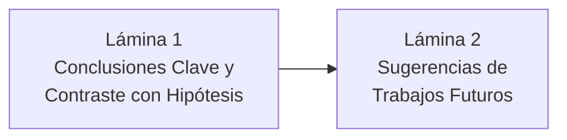

# Guía de Exposición: Sección de Conclusiones y Sugerencias de Trabajos Futuros
**Curso:** Inteligencia Artificial (1INF24) — Tarea Académica  
**Proyecto:** Clasificación de la Pobreza Monetaria en Lima Metropolitana mediante Aprendizaje Supervisado sobre Microdatos de la ENAHO  
**Autores:** Gael Sebastian Arias Escalante, Melanie Nadine Mallqui Huaraz, Valeshka del Pilar Lavado Guerra, Edilvan Franco Salcedo Enciso  

---

## 📌 1. Objetivos y Dinámica de la Exposición

La defensa de la sección de **Conclusiones y Trabajos Futuros** tiene una duración estimada de **2 a 3 minutos**. Su propósito es sintetizar los hallazgos principales del proyecto, contrastarlos directamente contra las hipótesis iniciales y proyectar cómo esta investigación puede escalar hacia aplicaciones del mundo real en el sector público.

Debe dejar claras 3 ideas de cierre:
1. **El cierre del círculo científico:** Cómo los resultados numéricos responden a las hipótesis H1–H4.
2. **El aprendizaje metodológico central:** Por qué la calidad y multidimensionalidad de los datos supera a la complejidad del algoritmo.
3. **El roadmap futuro:** Datos satelitales, Deep Learning tabular (TabNet) y despliegue operativo para asistentes sociales.

---

## 🎞️ 2. Estructura Lámina por Lámina (Slide-by-Slide)

---

### 🔹 LÁMINA 1: Conclusiones Principales y Contraste de Hipótesis
* **Tiempo sugerido:** 60 - 75 segundos
* **Título de la diapositiva:** Conclusiones Principales del Proyecto
* **Elementos visuales a incluir:**
  * Cuatro conclusiones sintetizadas con íconos:
    1. **Caída del Mito Físico:** El 59.4% de los pobres urbanos viven en casas con paredes de ladrillo. Las heurísticas basadas solo en materiales son ciegas a la pobreza monetaria urbana.
    2. **Primacía de la Información (H1 confirmada):** Integrar demografía, educación y empleo incrementó la PR-AUC en $+0.190$ frente a solo vivienda.
    3. **Paridad Algorítmica (H2 confirmada):** A igual cobertura presupuestal ($B=20\%$), los modelos lineales regularizados compiten palmo a palmo con los ensambles (diferencia de exclusión $< 1$ punto porcentual).
    4. **Robustez y Viabilidad Operativa (H3 y H4 confirmadas):** Se alcanza un $\text{Recall} \ge 70\%$ con precisión de $44.6\%$, y la degradación temporal en 2025 fue marginal ($\Delta \text{PR-AUC} = -0.022$).

#### 🗣️ Guión Verbal (Talking Points):
> *"Para concluir nuestra investigación, queremos destacar cuatro aprendizajes fundamentales que responden directamente a las hipótesis planteadas:*
> 
> * *Primero, **desmitificamos los indicadores físicos en entornos urbanos**. En Lima y Callao, casi el 60% de los hogares pobres residen en viviendas con paredes de ladrillo y techos consolidados gracias a décadas de autoconstrucción. Juzgar la vulnerabilidad solo por los materiales físicos es metodológicamente inviable.*
> * *Segundo, confirmamos que **la calidad y multidimensionalidad de los datos supera a la complejidad algorítmica**: caracterizar el capital humano, la carga demográfica y la informalidad laboral elevó la PR-AUC en 19 puntos porcentuales.*
> * *Tercero, a igual restricción presupuestal del Estado ($B=20\%$), los modelos lineales fuertemente regularizados rinden prácticamente a la par de ensambles complejos de árboles como Random Forest y LightGBM.*
> * *Y cuarto, validamos que el clasificador es **operativamente viable y temporalmente robusto**, capturando a 7 de cada 10 familias pobres con una degradación mínima de un año a otro."*

---

### 🔹 LÁMINA 2: Sugerencias de Trabajos Futuros y Escalabilidad
* **Tiempo sugerido:** 45 - 60 segundos
* **Título de la diapositiva:** Extensiones y Trabajo Futuro
* **Elementos visuales a incluir:**
  * Cuatro vectores de investigación futura:
    1. **Metadatos Satelitales y Geoespaciales:** Incorporar imágenes nocturnas (*Nighttime Lights - NTL*), vegetación (NDVI) y distancias viales de OpenStreetMap a nivel de conglomerado.
    2. **Deep Learning Tabular Moderno:** Explorar arquitecturas como **TabNet** (con mecanismos de atención secuencial) y Multilayer Perceptrons con *Entity Embeddings*.
    3. **Clasificación Multiclase de Vulnerabilidad:** Escalar de clasificación binaria a 3 estratos: Pobreza Extrema, Pobreza No Extrema y Hogares Vulnerables no pobres (en riesgo de caer en pobreza).
    4. **Despliegue Operativo en Campo:** Contenerización con Docker, API en FastAPI y dashboard en Streamlit para asistentes sociales y brigadas del SISFOH.

#### 🗣️ Guión Verbal (Talking Points):
> *"A partir de estos resultados, planteamos cuatro rutas claras de trabajo futuro:*
> 
> * *1. **Integración Geoespacial y Satelital:** Enriquecer las variables de la ENAHO con luminosidad nocturna satelital y distancias a centros de salud y vías principales, capturando la infraestructura pública del barrio.*
> * *2. **Arquitecturas de Deep Learning Tabular:** Evaluar modelos basados en atención como TabNet para evaluar si logran aprender patrones latentes que superen a los árboles de gradiente.*
> * *3. **Segmentación Multiclase:** Extender el target a tres clases para identificar no solo a los pobres actuales, sino a la clase media vulnerable en riesgo de recaída por shocks inflacionarios.*
> * *4. **Despliegue e Interfaz Operativa:** Empaquetar este pipeline en una API REST y una aplicación web interactiva que permita a los empadronadores de campo ingresar la ficha socioeconómica y recibir en tiempo real la probabilidad calibrada junto con su explicación en TreeSHAP."*

---

## 🎯 3. Conceptos Clave para Defender en Conclusiones

1. **Lección Metodológica Central:** "More data beats cleverer algorithms" (La riqueza de la representación multidimensional explica el salto en desempeño).
2. **Cumplimiento Total de Hipótesis:** H1, H2, H3 y H4 verificadas cuantitativamente con soporte estadístico.
3. **Escalabilidad hacia Políticas Públicas:** El modelo no es un prototipo aislado; tiene un camino claro de despliegue en entidades como el MIDIS o el SISFOH.
4. **Resistencia al Concept Drift:** El modelo demostró generalización estable fuera de tiempo al pasar de 2024 a 2025.

---

## 🛡️ 4. Preguntas Frecuentes del Jurado sobre Conclusiones

### P1: *"¿Cuál es la recomendación concreta que su equipo le daría al Ministerio de Desarrollo e Inclusión Social (MIDIS)?"*
* **Respuesta Experta:**  
  *"Nuestra recomendación principal es actualizar el instrumento de focalización urbana del SISFOH hacia un modelo supervisado de Proxy Means Testing que priorice variables de capital humano (máximo nivel educativo familiar), carga de dependencia infantil y condición de informalidad laboral, en lugar de sobredimensionar los materiales físicos de la vivienda. Asimismo, recomendamos evaluar los instrumentos bajo cobertura presupuestal fija y auditar periódicamente la estabilidad temporal del clasificador frente a la inflación."*

---

## ⏱️ 5. Resumen de Tiempos

| Lámina | Contenido Principal | Tiempo | Enfoque |
| :---: | :--- | :---: | :--- |
| **L1** | Conclusiones y Contraste de Hipótesis H1–H4 | 1:15 | Síntesis rigurosa y confirmación de metas. |
| **L2** | Sugerencias Futuras y Escalabilidad Operativa | 0:55 | Visión de impacto, innovación tecnológica y futuro. |
| **Total** | **Sección Conclusiones y Trabajo Futuro** | **~2:10** | **Cierre contundente, maduro y convincente.** |
