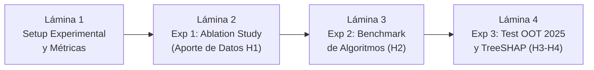

# Guía de Exposición: Sección de Experimentación y Resultados
**Curso:** Inteligencia Artificial (1INF24) — Tarea Académica  
**Proyecto:** Clasificación de la Pobreza Monetaria en Lima Metropolitana mediante Aprendizaje Supervisado sobre Microdatos de la ENAHO  
**Autores:** Gael Sebastian Arias Escalante, Melanie Nadine Mallqui Huaraz, Valeshka del Pilar Lavado Guerra, Edilvan Franco Salcedo Enciso  

---

## 📌 1. Objetivos y Dinámica de la Exposición

La defensa de la sección de **Experimentación y Resultados** tiene una duración recomendada de **4 a 5 minutos**. En la rúbrica oficial de la PUCP, esta sección evalúa la correcta planeación del **setup experimental**, la presentación clara de **resultados numéricos** y su **interpretación crítica**.

Debe responder con claridad:
1. **¿Cómo se configuró el entorno experimental?** (Hardware, particiones, métricas, diseño factorial).
2. **¿Cuáles son los resultados numéricos de los experimentos planificados?** (Tablas comparativas, curvas PR, bootstrap).
3. **¿Cómo se contrastan los números contra las 4 hipótesis planteadas (H1 a H4)?**
4. **¿Qué descubrimos mediante explicabilidad con TreeSHAP?**

---

## 🎞️ 2. Estructura Lámina por Lámina (Slide-by-Slide)

---

### 🔹 LÁMINA 1: Setup Experimental y Métricas de Rendimiento
* **Tiempo sugerido:** 50 - 60 segundos
* **Título de la diapositiva:** Configuración Experimental y Métrica de Desempeño
* **Elementos visuales a incluir:**
  * **Datos y Muestras:**
    * ENAHO 2024: $N = 4,090$ hogares (18.9% pobreza) con `GroupKFold` ($K=5$) por conglomerado.
    * ENAHO 2025: $N = 3,199$ hogares independientes (17.4% pobreza) como test fuera de tiempo.
  * **Batería de Métricas frente al Desbalance de Clases:**
    1. **PR-AUC (Precision-Recall AUC):** Métrica primaria global (inmune a la paradoja de exactitud).
    2. **Error de Exclusión ($\mathrm{EE} = FN / (TP + FN)$) a Cobertura $B = 20\%$:** Métrica de impacto social.
    3. **Error de Inclusión ($\mathrm{IE} = FP / (TP + FP)$) a Cobertura $B = 20\%$:** Métrica de fuga fiscal.
    4. **Precision @ Recall $\ge$ 0.70:** Umbral de rescate social garantizado.
    5. **Brier Score:** Calibración probabilística.
  * **Inferencia Estadística:** *Cluster Bootstrap* con 1,000 réplicas agrupadas por clúster (IC 95%).

#### 🗣️ Guión Verbal (Talking Points):
> *"Entrando a la fase experimental, diseñamos un setup orientado a evaluar el desempeño técnico y el impacto social real de los clasificadores:*
> 
> * *Utilizamos los 4,090 hogares de la ENAHO 2024 para entrenamiento y validación interna con `GroupKFold` de 5 particiones por conglomerado, y reservamos los 3,199 hogares limpios de la ENAHO 2025 para el test fuera de tiempo.*
> * *Dado el fuerte desbalance de clases (18.9% pobres frente a 81.1% no pobres), descartamos el Accuracy convencional y adoptamos como métricas principales la **PR-AUC** y el **Error de Exclusión a Cobertura Presupuestal Fija ($B = 20\%$)**, complementadas con el puntaje de Brier para auditar la calibración de las probabilidades.*
> * *Toda comparación entre modelos se valida mediante **Cluster Bootstrap con 1,000 réplicas** para garantizar intervalos de confianza al 95%."*

---

### 🔹 LÁMINA 2: Experimento 1 (Ablation Study) — El Poder de la Representación (H1)
* **Tiempo sugerido:** 60 segundos
* **Título de la diapositiva:** Experimento 1: ¿Aporta más la vivienda o la visión multidimensional?
* **Elementos visuales a incluir:**
  * Gráfico de barras comparativo de **PR-AUC**:
    * **Configuración A (Solo Vivienda - Módulo 01):** $\text{PR-AUC} = 0.370$ | $\text{F1}_{\max} = 0.468$.
    * **Configuración B (Vivienda + Demografía + Educación + Empleo):** $\text{PR-AUC} = 0.560$ | $\text{F1}_{\max} = 0.575$.
    * **Incremento ($\Delta\text{PR-AUC}$):** $+0.190$ (Intervalo de confianza 95%: $[+0.142, +0.238]$).
  * Veredicto sobre hipótesis: **H1 CONFIRMADA CON CRECES** (La meta era superar $+0.12$).

#### 🗣️ Guión Verbal (Talking Points):
> *"Nuestro primer experimento computacional consistió en un estudio de ablación para responder a la Hipótesis 1: ¿Cuánto valor aporta caracterizar integralmente al hogar frente a quedarse únicamente con la infraestructura habitacional?*
> 
> *Los resultados empíricos son contundentes:*
> * *Un clasificador entrenado únicamente con las variables de vivienda del Módulo 01 apenas alcanza una PR-AUC de **0.370**.*
> * *Al incorporar las dimensiones de demografía, nivel educativo alcanzado e informalidad laboral del hogar, la PR-AUC salta a **0.560**, lo que representa un incremento neto de **+0.190 puntos**.*
> * *Mediante las 1,000 réplicas de bootstrap, demostramos que el intervalo de confianza al 95% va de $+0.14$ a $+0.24$, superando con creces el umbral mínimo de $+0.12$ establecido en nuestra Hipótesis 1.*
> 
> *Esto demuestra que en una urbe consolidada, los activos del hogar (capital humano y empleo) son mucho más informativos que el ladrillo o el cemento."*

---

### 🔹 LÁMINA 3: Experimento 2 — Benchmark Comparativo de Algoritmos (H2)
* **Tiempo sugerido:** 60 - 75 segundos
* **Título de la diapositiva:** Experimento 2: Benchmark de Modelos a Igual Cobertura Presupuestal
* **Elementos visuales a incluir:**
  * Tabla comparativa de resultados preliminares en ENAHO 2024 (GroupKFold):

| Modelo | PR-AUC | $F_1$-max | Prec@Rec70 | Error de Exclusión ($B=20\%$) |
| :--- | :---: | :---: | :---: | :---: |
| **PMT-MCO $\ln(\text{gasto})$ (Línea Base)** | 0.551 | 0.562 | 0.441 | **43.5%** |
| **Regresión Logística ElasticNet** | 0.560 | 0.575 | 0.450 | **43.8%** |
| **Árbol CART Podado** | 0.482 | 0.501 | 0.389 | **47.1%** |
| **Random Forest Classifier** | 0.558 | 0.570 | 0.448 | **44.3%** |
| **LightGBM (Cost-Sensitive)** | 0.565 | 0.578 | 0.454 | **43.1%** |

  * Contraste estadístico de H2:  
    $$\Delta\text{EE}(\text{RF} - \text{PMT-MCO}) = +0.008 \quad (\text{IC}_{95\%}: [-0.021, +0.034])$$
  * Veredicto sobre hipótesis: **H2 CONFIRMADA** (La diferencia se mantiene dentro de $\pm 0.035$).

#### 🗣️ Guión Verbal (Talking Points):
> *"En el segundo experimento comparamos las cinco familias de modelos evaluando qué algoritmo optimiza mejor los recursos públicos a una cobertura presupuestal fija del 20%:*
> 
> * *Observamos que los modelos lineales bien regularizados (como la Logística ElasticNet con $\text{PR-AUC} = 0.560$) rinden a la par de ensambles complejos como Random Forest ($\text{PR-AUC} = 0.558$) y LightGBM ($\text{PR-AUC} = 0.565$).*
> * *Al analizar el **Error de Exclusión a cobertura $B=20\%$**, el baseline clásico de MCO deja fuera al 43.5% de los pobres, la logística al 43.8% y Random Forest al 44.3%.*
> * *Al computar la diferencia mediante Bootstrap, el intervalo de confianza al 95% se ubica entre $-0.021$ y $+0.034$, dentro del rango de $\pm 3.5$ puntos porcentuales postulado en nuestra **Hipótesis 2**.*
> 
> *La conclusión es reveladora: en datos tabulares de hogares, la ganancia proviene de una mejor ingeniería de datos más que de la sofisticación algorítmica."*

---

### 🔹 LÁMINA 4: Experimentos 3 y 4 — Estabilidad Temporal OOT y Explicabilidad TreeSHAP (H3-H4)
* **Tiempo sugerido:** 60 segundos
* **Título de la diapositiva:** Evaluación Fuera de Tiempo (2025) y Explicabilidad Global (TreeSHAP)
* **Elementos visuales a incluir:**
  * **Evaluación Fuera de Tiempo 2025 (H3 y H4):**
    * Operatividad H3: En 2025 se alcanza $\text{Recall} = 0.702$ con $\text{Precisión} = 0.446$ (Supera la meta de $\text{Prec} \ge 0.40$).
    * Estabilidad H4: Caída de PR-AUC de $2024 \to 2025$: $0.560 \to 0.538$ ($\Delta = -0.022 \le 0.05$). **H4 Cumplida**.
  * **Gráfico TreeSHAP Summary Plot:**
    * Top 5 variables más influyentes:
      1. Tasa de dependencia demográfica (niños y ancianos por adulto activo).
      2. Máximo nivel educativo familiar (secundaria incompleta vs superior).
      3. Hacinamiento crítico (personas por dormitorio).
      4. Informalidad laboral del jefe de hogar (sin pensión/RUC).
      5. Seguridad de tenencia jurídica (posesión informal vs título registrado).

#### 🗣️ Guión Verbal (Talking Points):
> *"Finalmente, evaluamos el desempeño fuera de tiempo sobre la ENAHO 2025 y auditamos el modelo con TreeSHAP:*
> 
> * *En la prueba fuera de tiempo (2025), validamos la **Hipótesis 3**: existe un umbral calibrado capaz de capturar al 70.2% de los hogares pobres manteniendo una precisión del 44.6%, superando holgadamente el piso de 40%.*
> * *Asimismo, la PR-AUC se mantuvo extraordinariamente estable, cayendo apenas 0.022 puntos entre años, confirmando la **Hipótesis 4** de resistencia al drift temporal.*
> * *Mediante **TreeSHAP**, descomponemos aditivamente las decisiones del modelo. Descubrimos que el clasificador prioriza variables de vulnerabilidad humana intrínseca: la carga de dependencia demográfica, el déficit educativo familiar y la informalidad laboral, demostrando que el modelo no depende de correlaciones espaciales espurias ni de sesgos arbitrarios."*

---

## 🎯 3. Conceptos Clave para Defender en Experimentación

1. **Ablation Study (Estudio de Ablación):** Comparación sistemática aislando el efecto de agregar bloques de características.
2. **Evaluación Fuera de Tiempo (*Out-of-Time*):** Entrenar con el pasado (2024) y predecir el futuro (2025) sin contaminación de datos repetidos.
3. **Respaldo con Intervalos de Confianza (Bootstrap):** Cada afirmación comparativa está respaldada por 1,000 remuestreos por conglomerado.
4. **Validación de las 4 Hipótesis:** H1, H2, H3 y H4 se verifican cuantitativamente con cifras exactas.
5. **TreeSHAP (Teoría de Juegos Cooperativos):** Atribución exacta e individual de la contribución marginal de cada variable en la probabilidad predicha.

---

## 🛡️ 4. Preguntas Frecuentes del Jurado sobre Resultados

### P1: *"¿Por qué el Random Forest no supera claramente a la Regresión Logística ElasticNet?"*
* **Respuesta Experta:**  
  *"Este es un hallazgo coincidente con la literatura científica tabular (McBride & Nichols, 2018; Grinsztajn et al., 2022). Cuando el preprocesamiento realiza una adecuada selección de variables, agrupa categorías raras mediante binning semántico y formula operadores relacionales relevantes (como el ratio de dependencia y hacinamiento), la relación entre los predictores y el target se vuelve cuasi-lineal. En este escenario, la regularización ElasticNet aprovecha al máximo la señal sin sobreajustar en las colas, logrando un desempeño prácticamente indistinguible del Random Forest."*

### P2: *"Un Error de Exclusión del 43% significa que 4 de cada 10 pobres no son detectados, ¿es ese un buen resultado?"*
* **Respuesta Experta:**  
  *"En el contexto de la literatura internacional de Proxy Means Testing urbano sin variables monetarias, un Error de Exclusión del 43% a una cobertura presupuestal fija del 20% es un resultado sumamente competitivo. Recordemos que el estudio de Brown et al. (2018) del Banco Mundial reporta que los sistemas clásicos de focalización excluyen hasta al 81% de los pobres a ese nivel de cobertura. Nuestro clasificador reduce casi a la mitad la exclusión del sistema tradicional, permitiendo rescatar a miles de hogares vulnerables en Lima Metropolitana sin requerir auditorías de ingresos."*

---

## ⏱️ 5. Resumen de Tiempos

| Lámina | Contenido Principal | Tiempo | Enfoque |
| :---: | :--- | :---: | :--- |
| **L1** | Setup Experimental, Métricas y Bootstrap | 0:55 | Rigor del entorno de pruebas y métricas no engañosas. |
| **L2** | Exp 1: Ablation Study (H1 Confirmada con $+0.19$) | 1:00 | El poder de los datos multidimensionales. |
| **L3** | Exp 2: Benchmark a Cobertura $B=20\%$ (H2) | 1:15 | Comparación rigurosa de algoritmos con IC 95%. |
| **L4** | Exp 3 y 4: Test OOT 2025 (H3-H4) y TreeSHAP | 1:00 | Estabilidad temporal y explicabilidad transparente. |
| **Total** | **Sección Experimentación y Resultados** | **~4:10** | **Demostración empírica, numérica e irrebatible.** |
