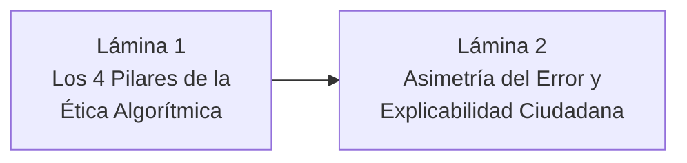

# Guía de Exposición: Sección de Implicancias Éticas y Responsabilidad Social
**Curso:** Inteligencia Artificial (1INF24) — Tarea Académica  
**Proyecto:** Clasificación de la Pobreza Monetaria en Lima Metropolitana mediante Aprendizaje Supervisado sobre Microdatos de la ENAHO  
**Autores:** Gael Sebastian Arias Escalante, Melanie Nadine Mallqui Huaraz, Valeshka del Pilar Lavado Guerra, Edilvan Franco Salcedo Enciso  

---

## 📌 1. Objetivos y Dinámica de la Exposición

La defensa de la sección de **Implicancias Éticas** tiene una duración estimada de **2 minutos**. En la rúbrica oficial de evaluación de la PUCP, esta sección evalúa si el grupo es consciente del impacto social, humano y legal de automatizar decisiones públicas mediante Inteligencia Artificial.

Debe responder con claridad:
1. **¿Qué riesgos humanos y sociales surgen si este modelo se implementa en el Estado?**
2. **¿Por qué un Falso Negativo es incomparablemente más grave que un Falso Positivo?**
3. **¿Cómo se garantiza el derecho ciudadano a la explicación y transparencia?** (TreeSHAP).
4. **¿Cómo se protege la privacidad y los datos personales según la ley peruana?**

---

## 🎞️ 2. Estructura Lámina por Lámina (Slide-by-Slide)

---

### 🔹 LÁMINA 1: Los 4 Pilares de la Ética Algorítmica en Políticas Públicas
* **Tiempo sugerido:** 60 segundos
* **Título de la diapositiva:** Ética, Equidad y Gobernanza de la Inteligencia Artificial
* **Elementos visuales a incluir:**
  * Cuatro tarjetas de mitigación ética:
    1. **Asimetría del Error Humano:** Un Falso Negativo priva de alimento o salud a una familia; un Falso Positivo solo implica costo fiscal marginal.
    2. **Mitigación de Sesgos Geográficos (*Redlining*):** Evitar "zonas rojas" donde hogares vulnerables sean discriminados por su código distrital o UBIGEO.
    3. **Derecho a la Explicabilidad Administrativa:** Desmantelamiento de la "caja negra" mediante **TreeSHAP** para posibilitar el derecho a apelación.
    4. **Privacidad y Protección de Datos:** Cumplimiento de la **Ley N° 29733** (Ley de Protección de Datos Personales del Perú) mediante anonimización irreversible.

#### 🗣️ Guión Verbal (Talking Points):
> *"Cuando aplicamos Inteligencia Artificial a la focalización social, las predicciones no son meras métricas abstractas: condicionan directamente si una familia vulnerable tiene acceso a alimentación, salud o transferencias estatales.*
> 
> *Por ello, nuestro proyecto incorpora un marco de ética algorítmica estructurado en cuatro pilares fundamentales:*
> * *1. **Asimetría moral del error:** Reconocemos que el costo de un Falso Negativo (excluir a un hogar pobre) es infinitamente superior al de un Falso Positivo. Por ello, calibramos el modelo con pérdidas sensibles al costo orientadas a maximizar la sensibilidad.*
> * *2. **Prevención del sesgo geográfico:** Cuidamos que el algoritmo aprenda de necesidades humanas intrínsecas (hacinamiento, dependencia y empleo) y no de discriminación por distrito o código postal.*
> * *3. **Explicabilidad y debido proceso:** Garantizamos que ninguna decisión sea una 'caja negra' inescrutable.*
> * *4. **Privacidad estricta:** Alineamos el pipeline al marco de la Ley Peruana de Protección de Datos Personales."*

---

### 🔹 LÁMINA 2: Explicabilidad con TreeSHAP y Garantía Ciudadana
* **Tiempo sugerido:** 60 segundos
* **Título de la diapositiva:** Transparencia Algorítmica: De la "Caja Negra" a la Ficha Explicable
* **Elementos visuales a incluir:**
  * Diagrama de una **Ficha de Decisión Ciudadana generada con TreeSHAP**:
    * Predicción del hogar: $P(\text{Pobreza}) = 0.78$ $\to$ Hogar Elegible.
    * Desglose aditivo transparente de Shapley Values:
      * $+0.24$: Alta tasa de dependencia infantil (3 menores de 5 años).
      * $+0.18$: Jefe de hogar en subempleo informal sin pensión.
      * $+0.12$: Hacinamiento crítico (4 personas por habitación).
      * $-0.06$: Acceso formal a red pública de agua.
  * Mensaje de principio: **"Todo ciudadano tiene el derecho constitucional a saber por qué fue incluido o excluido de un beneficio estatal"**.

#### 🗣️ Guión Verbal (Talking Points):
> *"En el Estado moderno, ningún algoritmo puede operar como una 'caja negra'. Si a un ciudadano se le deniega un subsidio social, la administración pública tiene el deber legal y ético de justificar las razones de esa decisión.*
> 
> *Para resolver esto, implementamos explicabilidad local mediante **TreeSHAP**, basado en la teoría de juegos cooperativos.*
> 
> *Como vemos en el ejemplo de esta ficha, el modelo desglosa con exactitud matemática el aporte de cada característica: la probabilidad del 78% se explica por la presencia de tres menores a cargo (+0.24), la informalidad laboral (+0.18) y el hacinamiento (+0.12). Esto permite auditar posibles sesgos indebidos, transparentar el gasto público y garantizar el derecho ciudadano de apelación ante cualquier inconsistencia administrativa."*

---

## 🎯 3. Conceptos Clave para Defender en Implicancias Éticas

1. **Severidad Asimétrica del Error:** La justificación ética de por qué se prioriza el Recall y se minimiza el Error de Exclusión social.
2. **Redlining / Discriminación Espacial:** El riesgo de castigar a familias pobres que viven en distritos consolidados o de clase media.
3. **TreeSHAP como Garantía del Debido Proceso:** Cómo los valores Shapley transforman modelos opacos (árboles de decisión o boosting) en instrumentos transparentes y auditables.
4. **Ley N° 29733 (Perú):** Marco legal peruano sobre privacidad, anonimización y uso de datos sensibles en el sector público.

---

## 🛡️ 4. Preguntas Frecuentes del Jurado sobre Ética

### P1: *"¿Qué pasaría si un ciudadano reclama que el modelo se equivocó y lo dejó fuera de un bono?"*
* **Respuesta Experta:**  
  *"Gracias a la integración de TreeSHAP, el sistema no entrega un veredicto ciego, sino una hoja de descomposición de atribuciones que señala exactamente qué factores determinaron su puntaje. Si el ciudadano demuestra mediante una visita domiciliaria que hubo un dato desactualizado (por ejemplo, que el jefe de hogar perdió su empleo formal o que aumentó el número de dependientes), el sistema permite reevaluar la ficha de forma transparente y corregir la asignación sin arbitrariedades."*

### P2: *"¿Existe riesgo de que las personas mientan en la encuesta para calificar como pobres?"*
* **Respuesta Experta:**  
  *"Ese es uno de los principios rectores de nuestra selección de variables: priorizamos características difíciles de falsificar a corto plazo o que conllevan un alto costo de simulación (como el máximo nivel educativo alcanzado en la familia, la composición demográfica verificable o las características físicas de la vivienda), en contraste con el autoreporte de ingresos o gastos en efectivo, que es fácilmente manipulable."*

---

## ⏱️ 5. Resumen de Tiempos

| Lámina | Contenido Principal | Tiempo | Enfoque |
| :---: | :--- | :---: | :--- |
| **L1** | Los 4 Pilares de la Ética Algorítmica | 1:00 | Riesgo social, asimetría moral y legalidad. |
| **L2** | Transparencia y Explicabilidad con TreeSHAP | 1:00 | Desmantelamiento de la caja negra y derechos ciudadanos. |
| **Total** | **Sección Implicancias Éticas** | **~2:00** | **Madurez ética, responsabilidad social y rigor legal.** |
