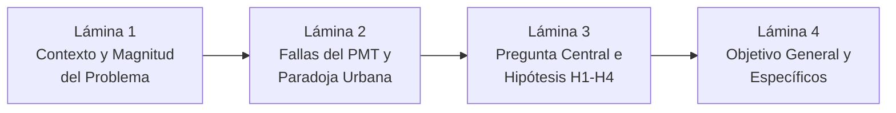

# Guía de Exposición: Sección de Introducción, Hipótesis y Objetivos
**Curso:** Inteligencia Artificial (1INF24) — Tarea Académica  
**Proyecto:** Clasificación de la Pobreza Monetaria en Lima Metropolitana mediante Aprendizaje Supervisado sobre Microdatos de la ENAHO  
**Autores:** Gael Sebastian Arias Escalante, Melanie Nadine Mallqui Huaraz, Valeshka del Pilar Lavado Guerra, Edilvan Franco Salcedo Enciso  

---

## 📌 1. Objetivos y Dinámica de la Exposición

La defensa de la sección de **Introducción** abre la exposición y debe tomar entre **3 y 4 minutos**. Su objetivo principal es captar la atención del jurado, justificar por qué este problema amerita técnicas de Inteligencia Artificial y no simples estadísticas, y plantear hipótesis y objetivos medibles y alcanzables.

Debe dejar claros 3 puntos clave:
1. **La urgencia y magnitud del problema:** La pobreza urbana post-pandemia en Lima y la grave falla de focalización del Estado.
2. **Por qué las reglas heurísticas o simples fallan:** El mito de los materiales de la vivienda en Lima.
3. **Las 4 hipótesis cuantitativas y objetivos:** Qué preguntas científicas responderá el proyecto con números exactos.

---

## 🎞️ 2. Estructura Lámina por Lámina (Slide-by-Slide)

---

### 🔹 LÁMINA 1: Contexto, Magnitud y Relevancia Social
* **Tiempo sugerido:** 45 - 60 segundos
* **Título de la diapositiva:** El Desafío de la Pobreza Urbana en Lima Metropolitana
* **Elementos visuales a incluir:**
  * Mapa o silueta de Lima Metropolitana y Callao (`DOMINIO = 8` de la ENAHO).
  * Estadísticas de impacto con tipografía grande:
    * **28.2% de la población (3.2 millones de personas)** en pobreza monetaria al 2024 (se duplicó frente al 14.2% del 2019).
    * **1/3 de todos los pobres del Perú** residen hoy en Lima y Callao.
    * Canasta básica individual oficial: **S/ 559.20 mensuales**.
  * Gráfico de brecha: **67.2% de los hogares pobres en Lima (520 de 774) NO reciben ningún programa social** (transferencias monetarias ni donaciones alimentarias).

#### 🗣️ Guión Verbal (Talking Points):
> *"Buenas tardes, profesores y compañeros. Hoy les presentamos nuestro proyecto de investigación enfocado en resolver uno de los desafíos más urgentes de nuestro país: la clasificación de la pobreza urbana en Lima Metropolitana y Callao mediante aprendizaje automático.*
> 
> *Tradicionalmente, la pobreza en el Perú se ha concebido como un fenómeno rural. Sin embargo, tras la pandemia, la pobreza urbana en Lima se duplicó: pasó de 14.2% a 28.2% en 2024. Hoy, 3.2 millones de personas en la capital no logran cubrir el costo de una canasta básica familiar.*
> 
> *Lo más crítico es la brecha de protección social: de acuerdo con los microdatos de la ENAHO 2024, el 67.2% de las familias pobres de Lima no recibe transferencias ni apoyo alimentario del Estado. Una de las razones principales es la ineficacia de los mecanismos actuales para identificar oportunamente a las familias en vulnerabilidad urbana."*

---

### 🔹 LÁMINA 2: La Paradoja Urbana y la Justificación de la IA
* **Tiempo sugerido:** 60 segundos
* **Título de la diapositiva:** ¿Por qué falla la intuición? La Paradoja de los Indicadores Físicos
* **Elementos visuales a incluir:**
  * Gráfico de barras o contraste visual:
    * **84.5% de los hogares en Lima tienen paredes de ladrillo/concreto**.
    * En hogares con pared de ladrillo, la pobreza es del **15.5%** (representan la mayoría absoluta de los pobres en volumen).
    * En viviendas precarias (madera/estera), la pobreza es del **40.0%**, pero el 60% restante NO son pobres monetarios.
  * Por qué no se puede auditar el ingreso: Alta volatilidad e informalidad laboral (>90% de la expansión urbana reciente fue informal).
  * Conclusión visual: **"La pobreza no es visible a simple vista; requiere capturar patrones no lineales multidimensionales (Machine Learning)"**.

#### 🗣️ Guión Verbal (Talking Points):
> *"¿Por qué los métodos tradicionales fallan al identificar a los pobres urbanos? Porque en la ciudad, las señales visibles clásicas pierden poder discriminante.*
> 
> *Históricamente, los programas sociales asumían que una vivienda con paredes de ladrillo o loseta correspondía a una familia consolidada. Sin embargo, la evidencia empírica en Lima desmiente esta regla:*
> * *El 84.5% de las viviendas en Lima son de ladrillo gracias a décadas de autoconstrucción.*
> * *Dentro de esas casas de ladrillo, la tasa de pobreza es del 15.5%, concentrando en volumen a casi el 60% de los pobres totales de la capital.*
> * *Por el contrario, en casas de madera, 6 de cada 10 hogares NO son pobres monetarios.*
> 
> *A diferencia del campo, en la ciudad las familias sufren de ingresos volátiles y alta informalidad. Medir sus gastos diarios es inviable operativamente, y guiarse por simples reglas físicas es engañoso. Aquí es donde el Machine Learning se vuelve indispensable: para aprender patrones no lineales complejos entre la vivienda, la demografía, la educación y el empleo informal."*

---

### 🔹 LÁMINA 3: Pregunta Central e Hipótesis Falseables (H1 a H4)
* **Tiempo sugerido:** 60 segundos
* **Título de la diapositiva:** Pregunta de Investigación e Hipótesis Científicas
* **Elementos visuales a incluir:**
  * **Pregunta Central:**  
    *¿Qué factor aporta más al desempeño predictivo fuera de tiempo: una caracterización multidimensional del hogar o la complejidad del algoritmo?*
  * **Las 4 Hipótesis Cuantitativas:**
    * **H1 (Representación):** Integrar demografía, educación y empleo a la vivienda aumenta la PR-AUC en al menos $+0.12$.
    * **H2 (Algoritmo):** A igual presupuesto ($B=20\%$), el error de exclusión de los ensambles difiere en menos de $\pm 3.5$ puntos porcentuales frente a modelos lineales.
    * **H3 (Operatividad):** Existe un punto operativo con $\text{Recall} \ge 0.70$ y $\text{Precisión} \ge 0.40$ en el test 2025.
    * **H4 (Estabilidad Temporal):** La degradación de PR-AUC entre 2024 y 2025 es menor a $0.05$.

#### 🗣️ Guión Verbal (Talking Points):
> *"Nuestra investigación no es un simple ejercicio de ajuste de curvas, sino que se guía por una pregunta científica central:*  
> *¿Qué aporta más a la detección de la pobreza urbana: recopilar más dimensiones del hogar o utilizar algoritmos más complejos?*
> 
> *Para responderla, formulamos cuatro hipótesis cuantitativas y falseables:*
> * *En **H1**, postulamos que la riqueza de la información supera a la vivienda aislada, esperando un incremento de al menos 12 puntos en PR-AUC.*
> * *En **H2**, testeamos si la complejidad algorítmica de los ensambles realmente supera a los modelos econométricos tradicionales a igual presupuesto, o si su diferencia en Error de Exclusión se mantiene dentro de un margen estrecho de 3.5 puntos porcentuales.*
> * *En **H3**, garantizamos la viabilidad operativa exigiendo un clasificador capaz de rescatar al menos al 70% de los pobres con una precisión mínima del 40%.*
> * *Y en **H4**, evaluamos la robustez temporal exigiendo que la degradación predictiva al año siguiente sea inferior a 0.05 en PR-AUC."*

---

### 🔹 LÁMINA 4: Objetivo General y Específicos
* **Tiempo sugerido:** 45 segundos
* **Título de la diapositiva:** Objetivos del Proyecto
* **Elementos visuales a incluir:**
  * **Objetivo General:** Desarrollar y evaluar comparativamente clasificadores supervisados para identificar hogares en pobreza monetaria en Lima y Callao con microdatos de la ENAHO, sin variables monetarias, priorizando el menor error de exclusión y estabilidad temporal.
  * **4 Objetivos Específicos:**
    1. *Datos:* Construir el dataset multimodular a nivel hogar para `DOMINIO = 8` y validar el target con INEI.
    2. *Ingeniería:* Diseñar el operador relacional individuo$\to$hogar ($\Phi$) para capturar carga demográfica y empleo.
    3. *Modelado:* Entrenar y comparar modelos econométricos (PMT-MCO), lineales y ensambles con pérdida sensible al costo.
    4. *Evaluación:* Evaluar fuera de tiempo en 2025 sin hogares panel, comparar a igual cobertura presupuestal y auditar con TreeSHAP.

#### 🗣️ Guión Verbal (Talking Points):
> *"Para dar respuesta a estas hipótesis, definimos nuestro objetivo general: desarrollar un sistema de clasificación supervisada capaz de predecir la vulnerabilidad monetaria sin usar ingresos ni gastos, priorizando minimizar el error de exclusión social y garantizando estabilidad en el tiempo.*
> 
> *Esto se articula en cuatro objetivos específicos que cubren desde la integración y validación oficial de los microdatos del INEI, la ingeniería del operador de reducción relacional individuo-hogar, el entrenamiento comparativo de modelos econométricos y de ensamble sensibles al costo, hasta la evaluación estricta fuera de tiempo en 2025 y la auditoría de explicabilidad con TreeSHAP."*

---

## 🎯 3. Conceptos Clave para Defender en la Introducción

1. **Magnitud de la Pobreza Urbana:** 28.2% en Lima, 3.2 millones de personas, 1 de cada 3 pobres peruanos vive en Lima.
2. **Falla de Cobertura Social:** 67.2% de los pobres de Lima no reciben transferencias públicas ni comedores populares.
3. **Pérdida de Poder de los Indicadores Físicos:** El 84.5% de viviendas son de ladrillo; los materiales solos no diferencian la pobreza urbana consolidada.
4. **Proxy Means Testing (PMT):** Técnica internacional recomendada por el Banco Mundial para inferir necesidad sin auditar ingresos diarios.
5. **Hipótesis Falseables:** Umbrales numéricos concretos ($+0.12$ PR-AUC, $\pm 0.035$ exclusión, $\text{Recall} \ge 0.70$).

---

## 🛡️ 4. Preguntas Frecuentes del Jurado sobre Introducción

### P1: *"¿Por qué delimitaron el estudio solo a Lima Metropolitana y Callao y no a todo el Perú?"*
* **Respuesta Experta:**  
  *"Porque los determinantes de la pobreza en el ámbito rural y urbano son estructuralmente diferentes. En la sierra rural, la tenencia de tierra, ganado o acceso a electricidad son proxies directos de pobreza. En Lima, la cobertura eléctrica es del 98.6% y el 84.5% vive en casas de ladrillo autoconstruidas; la pobreza urbana se oculta detrás de la informalidad laboral, la tasa de dependencia infantil y el hacinamiento. Mezclar ambos ámbitos distorsionaría las señales predictivas del clasificador."*

### P2: *"¿Cómo definieron la línea de pobreza que sirve como verdad de terreno (ground truth)?"*
* **Respuesta Experta:**  
  *"Utilizamos estrictamente el cálculo oficial de la pobreza monetaria total reportado por el INEI en el Módulo 34 (Sumaria), que compara el gasto per cápita mensual del hogar frente a la canasta básica familiar, la cual en 2024 se fijó en S/ 559.20 mensuales por persona para Lima Metropolitana. Nuestra variable objetivo se validó reproduciendo con exactitud la tasa oficial reportada por el INEI."*

---

## ⏱️ 5. Resumen de Tiempos

| Lámina | Contenido Principal | Tiempo | Enfoque |
| :---: | :--- | :---: | :--- |
| **L1** | Contexto y Magnitud (28.2%, 67% desprotegidos) | 0:50 | Urgencia del problema real en Lima. |
| **L2** | Paradoja Urbana (Mito del ladrillo y necesidad de IA) | 1:00 | Justificación técnica del Machine Learning. |
| **L3** | Pregunta de Investigación e Hipótesis (H1–H4) | 1:00 | Rigor cuantitativo y falseabilidad. |
| **L4** | Objetivo General y Específicos | 0:45 | Alcance y plan de trabajo claro. |
| **Total** | **Sección Introducción** | **~3:35** | **Apertura sólida, empática y de alto rigor.** |
