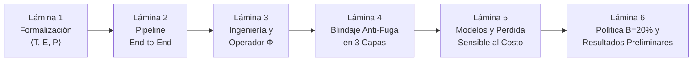

# Guía de Exposición: Sección de Metodología
**Curso:** Inteligencia Artificial (1INF24) — Tarea Académica  
**Proyecto:** Clasificación de la Pobreza Monetaria en Lima Metropolitana mediante Aprendizaje Supervisado sobre Microdatos de la ENAHO  
**Autores:** Gael Sebastian Arias Escalante, Melanie Nadine Mallqui Huaraz, Valeshka del Pilar Lavado Guerra, Edilvan Franco Salcedo Enciso  

---

## 📌 1. Objetivos y Dinámica de la Exposición

La defensa de la sección de **Metodología** tiene un tiempo objetivo de **4 a 5 minutos** dentro de la exposición grupal. Su propósito es convencer al jurado y al docente de que el equipo domina:
1. **La formulación rigurosa de Machine Learning** ($\langle T, E, P \rangle$).
2. **El tratamiento científico de los microdatos** (operadores ad-hoc, granularidad relacional, imputación).
3. **El blindaje metodológico contra sobreajuste y fuga** (*Zero Data Leakage*, `GroupKFold` espacial, purga de panel).
4. **La toma de decisiones algorítmica** (pérdida sensible al costo, comparación a igual cobertura presupuestal $B=20\%$).

---

## 🎞️ 2. Estructura Lámina por Lámina (Slide-by-Slide)

---

### 🔹 LÁMINA 1: Formalización Matemática y Espacio Entrada/Salida
* **Tiempo sugerido:** 45 - 60 segundos
* **Título de la diapositiva:** Formalización del Problema: Tarea, Experiencia y Desempeño
* **Elementos visuales a incluir:**
  * Marco de Tom Mitchell:
    $$\langle T, E, P \rangle$$
  * Variable objetivo:
    $$y_i = \mathbb{I}(\texttt{POBREZA}_i \in \{1, 2\}) \in \{0, 1\}$$
  * Espacio de entrada estructurado en 4 bloques: $\mathbf{x}_i \in \mathbb{R}^{28}$ (Vivienda, Demografía, Educación, Empleo).
  * Callout destacado: **"Zero Data Leakage: Exclusión estricta de ingresos y gastos de Sumaria"**.

#### 🗣️ Guión Verbal (Talking Points):
> *"Para abordar este desafío con rigor formal, enmarcamos el proyecto en el paradigma canónico de aprendizaje supervisado de Tom Mitchell mediante la terna T, E, P:*
> 
> * *Nuestra **Tarea ($T$)** consiste en inducir un clasificador binario que determine si un hogar $i$ se encuentra en situación de pobreza monetaria total, agrupando pobreza extrema y no extrema frente a hogares no pobres según el Módulo 34 del INEI.*
> * *Nuestra **Experiencia ($E$)** proviene de los microdatos oficiales de la ENAHO 2024 para Lima Metropolitana y Callao, con 4,090 hogares y una prevalencia de pobreza del 18.9%, dejando la ENAHO 2025 para una evaluación ciega fuera de tiempo.*
> * *Respecto al **Espacio de Entrada ($\mathbf{x}_i \in \mathbb{R}^{28}$)**, adoptamos el enfoque de **Proxy Means Testing**: excluimos de raíz las variables de ingreso y gasto monetario para evitar fuga de información (*data leakage*). El modelo aprende exclusivamente a partir de activos estructurales: materialidad de la vivienda, hacinamiento, tasa de dependencia, nivel educativo acumulado e informalidad laboral."*

---

### 🔹 LÁMINA 2: Flujo Metodológico End-to-End
* **Tiempo sugerido:** 30 - 40 segundos
* **Título de la diapositiva:** Arquitectura del Pipeline Metodológico
* **Elementos visuales a incluir:**
  * Diagrama de flujo de 4 fases (Figura 1 del informe LaTeX):
    1. **Ingesta:** Módulos 01, 02, 03, 05 y 34 de la ENAHO (`DOMINIO = 8`).
    2. **Ingeniería y Partición Anti-Fuga:** Operador $\Phi$, imputación intra-lote y partición espacial.
    3. **Modelado Sensible al Costo:** PMT-MCO, Logística ElasticNet, CART, Random Forest, LightGBM.
    4. **Inferencia y Política:** Cobertura presupuestal $B=20\%$, Cluster Bootstrap (1,000 réplicas) y TreeSHAP.

#### 🗣️ Guión Verbal (Talking Points):
> *"En esta lámina resumimos nuestro flujo de trabajo integral en cuatro fases secuenciales:*
> 
> 1. *Integramos microdatos de cinco módulos temáticos del INEI a dos niveles de granularidad.*
> 2. *Aplicamos ingeniería de datos relacional para agregar información de los miembros al hogar, junto con un riguroso protocolo de partición.*
> 3. *Entrenamos cinco familias algorítmicas bajo optimización sensible al costo para compensar el desbalance.*
> 4. *Y finalmente, evaluamos los modelos emulando la operación real de un programa social con coberturas presupuestales fijas y explicabilidad mediante TreeSHAP."*

---

### 🔹 LÁMINA 3: Ingeniería de Datos: Operador Relacional $\Phi$ y Calidad
* **Tiempo sugerido:** 50 - 60 segundos
* **Título de la diapositiva:** Operador de Reducción Relacional e Imputación Estructural
* **Elementos visuales a incluir:**
  * Esquema del **Operador $\Phi$ (Reducción Individuo $\to$ Hogar)**:
    * *Rama Jefe ($P203=1$):* Sexo, edad, nivel educativo, categoría ocupacional, horas de trabajo y pensión del decisor principal.
    * *Rama Núcleo del Hogar:* Tasa de dependencia demográfica, hacinamiento (personas por cuarto), máximo nivel educativo familiar y fracción de ocupados.
  * Esquema de **Imputación Intra-Vivienda (`ffill/bfill`)**:
    * Problema: 72 hogares secundarios (familias cohabitantes que alquilan cuartos) con 100% nulos en vivienda.
    * Solución: Herencia de atributos físicos restringida al par `(CONGLOME, VIVIENDA)` $\to$ **0.00% nulos sin inventar datos**.
  * Cuadro de decisión: **No poda de atípicos** en tamaño o dependencia para proteger a hogares vulnerables.

#### 🗣️ Guión Verbal (Talking Points):
> *"A nivel de datos resolvimos dos retos centrales:*
> 
> * *Primero, la **disparidad relacional**. La vivienda está registrada a nivel de hogar, pero la demografía, la educación y el empleo están a nivel de persona. Para consolidarlo en un único vector por hogar, diseñamos el operador relacional $\Phi$, que extrae las características del jefe de hogar por ser el principal ancla económica y sintetiza dinámicas colectivas clave: la tasa de dependencia demográfica, el hacinamiento y el nivel educativo máximo del hogar.*
> * *Segundo, el **tratamiento de valores faltantes**. Detectamos que el 1.76% de nulos en materiales ocurrían en hogares secundarios que comparten el mismo inmueble con una familia principal. Diseñamos un operador de imputación intra-vivienda que propaga las características físicas del inmueble dentro del mismo conglomerado y vivienda, eliminando los nulos a 0.00%. Asimismo, decidimos conscientemente no podar valores atípicos en tamaño de hogar para no excluir del análisis a familias numerosas en extrema vulnerabilidad."*

---

### 🔹 LÁMINA 4: La Joya Metodológica: Blindaje Anti-Fuga en 3 Capas
* **Tiempo sugerido:** 60 segundos
* **Título de la diapositiva:** Protocolo de Validación y Blindaje Anti-Fuga
* **Elementos visuales a incluir:**
  * Diagrama de 3 bloques verticales (Figura 2 del informe LaTeX):
    * **Capa 1: Entrenamiento y CV (ENAHO 2024, $N=4,090$):** `GroupKFold` ($K=5$) agrupado por `CONGLOME`.
    * **Capa 2: Purga de Panel Longitudinal:** Detección y eliminación de 930 hogares repetidos en 2025.
    * **Capa 3: Evaluación Fuera de Tiempo (Test 2025 independiente, $N=3,199$):** Evaluación a ciegas en año posterior.

#### 🗣️ Guión Verbal (Talking Points):
> *"Uno de los mayores aportes de nuestra metodología es el blindaje anti-fuga en tres capas para garantizar validez externa:*
> 
> * *1. **Validación espacial con `GroupKFold`:** El INEI utiliza un muestreo bietápico por conglomerados (manzanas contiguas). Una validación cruzada aleatoria tradicional provocaría fuga por autocorrelación espacial, ya que el modelo evaluaría hogares teniendo a sus vecinos directos en el conjunto de entrenamiento. Al agrupar estrictamente por `CONGLOME`, garantizamos cero fuga espacial.*
> * *2. **Purga del Panel Longitudinal:** Identificamos que el INEI mantiene una muestra panel donde 930 hogares encuestados en 2024 se repiten en 2025. Los purgamos por completo del conjunto de prueba para erradicar cualquier fuga longitudinal.*
> * *3. **Prueba Fuera de Tiempo (*Out-of-Time*):** Nuestro test final evalúa a ciegas sobre 3,199 hogares nuevos de 2025, midiendo la verdadera capacidad de generalización temporal frente a cambios en la economía urbana."*

---

### 🔹 LÁMINA 5: Modelos Supervisados y Pérdida Sensible al Costo
* **Tiempo sugerido:** 50 - 60 segundos
* **Título de la diapositiva:** Modelado Supervisado y Optimización Asimétrica
* **Elementos visuales a incluir:**
  * Tabla/Cuadrícula de los 5 algoritmos:
    1. *Baseline econométrico:* PMT-MCO sobre $\ln(\text{gasto per cápita})$.
    2. *Regresión Logística ElasticNet* ($L_1 + L_2$).
    3. *Árbol CART* con poda por costo-complejidad ($\alpha_{\text{ccp}}$).
    4. *Random Forest* (Bagging).
    5. *LightGBM* (Gradient Boosting).
  * Función de pérdida sensible al costo:
    $$\mathcal{L}(\theta) = -\frac{1}{N}\sum_{i=1}^N \bigl[\alpha y_i \ln \hat{p}_i + (1-y_i)\ln(1-\hat{p}_i)\bigr] + \lambda \Omega(\theta)$$
  * Principio de Elkan (2001): Tratar $\alpha \in \{1, 2, \gamma\}$ como hiperparámetro sin duplicar rebalanceo de pesos y ajuste de umbral.

#### 🗣️ Guión Verbal (Talking Points):
> *"En la etapa de modelado comparamos cinco algoritmos de complejidad creciente: la línea base clásica de la economía (un MCO sobre el logaritmo del gasto), una regresión logística regularizada con ElasticNet, árboles de decisión CART podados, Random Forest y LightGBM.*
> 
> *Para abordar el desbalance de clases (razón de desbalance de 4.28 a 1), optimizamos una **función de pérdida logística sensible al costo**, donde penalizamos asimétricamente el error de omitir a un hogar pobre (falso negativo).*
> 
> *Un aspecto metodológico crítico que adoptamos de **Elkan (2001)** es tratar el peso de clase $\alpha$ como un hiperparámetro de validación y **no duplicar correcciones**: reponderar la función de pérdida matemáticamente desplaza el umbral óptimo a $p^* = 1/(1+\alpha)$, por lo que aplicar pesos y calibración agresiva de umbral a la vez distorsionaría las probabilidades."*

---

### 🔹 LÁMINA 6: Política de Decisión, Inferencia y Evidencia Preliminar
* **Tiempo sugerido:** 50 - 60 segundos
* **Título de la diapositiva:** Política de Decisión ($B=20\%$), Inferencia y Resultados Preliminares
* **Elementos visuales a incluir:**
  * **Política a Cobertura Presupuestal Fija ($B = 0.20$):**
    $$\mathrm{EE} = \frac{FN}{TP + FN}, \quad \mathrm{IE} = \frac{FP}{TP + FP}$$
  * **Inferencia Estadística:** *Cluster Bootstrap* (1,000 réplicas por conglomerado con IC 95%).
  * **Evidencia preliminar demostrada (ENAHO 2024 con `GroupKFold`):**
    * Logística (solo vivienda): $\text{PR-AUC} = 0.370$.
    * Logística (4 módulos integrados): $\text{PR-AUC} = 0.560$ ($\Delta = +0.190$).
    * Error de Exclusión a $B=20\%$: PMT-MCO ($43.5\%$), Logística ($43.8\%$), Random Forest ($44.3\%$).

#### 🗣️ Guión Verbal (Talking Points):
> *"Para evaluar qué clasificador funciona mejor en un escenario de política social real, no usamos un umbral arbitrario de 0.5. Evaluamos a los modelos bajo una **cobertura presupuestal fija ($B = 20\%$)**, ordenando a los hogares por su probabilidad estimada y seleccionando al 20% más vulnerable para medir su Error de Exclusión.*
> 
> *Para determinar si las brechas entre modelos son estadísticamente significativas, implementamos **Cluster Bootstrap con 1,000 réplicas**.*
> 
> *Nuestros **resultados preliminares** en 2024 ya respaldan empíricamente nuestras hipótesis:*
> 1. *Integrar demografía, educación y empleo a la vivienda eleva la PR-AUC de 0.37 a 0.56, confirmando la necesidad de un enfoque multidimensional.*
> 2. *A igual cobertura presupuestal, los ensambles complejos y los modelos lineales difieren en menos de 3.5 puntos de error de exclusión. Esto sugiere que el mayor valor proviene de la representación del hogar y no meramente de la complejidad matemática del algoritmo."*

---

## 🎯 3. Las 5 "Balas de Plata" Conceptuales para el Jurado

Memoriza estos cinco conceptos para utilizarlos con convicción durante la presentación:

1. **Zero Data Leakage:** Exclusión intencional de variables monetarias de Sumaria para emular un Proxy Means Test real.
2. **Operador Relacional $\Phi$:** Transformación matemática fundamentada en la literatura (Grosh et al., 2022) para agregar atributos de personas al nivel de hogar.
3. **`GroupKFold` Espacial por Conglomerado:** Blindaje contra la correlación espacial que invalida la validación aleatoria simple en encuestas geográficas.
4. **Purga Longitudinal de Panel:** Eliminación de los 930 hogares repetidos entre 2024 y 2025 para asegurar una prueba fuera de tiempo estricta.
5. **Teorema de Elkan (2001):** Demostración formal de por qué no se debe reponderar la función de pérdida y recalibrar el umbral simultáneamente.

---

## 🛡️ 4. Banco de Preguntas Trampa del Docente / Jurado y Respuestas

### P1: *"¿Por qué no aplicaron técnicas generativas de sobremuestreo como SMOTE para balancear las clases?"*
* **Respuesta Experta:**  
  *"En microdatos socioeconómicos tabulares con fuerte presencia de variables categóricas y ordinales, SMOTE genera puntos sintéticos mediante interpolación euclidiana entre vecinos. Esto produce combinaciones artificialmente imposibles (ejemplo: inventar hogares con piso de tierra pero jefes con posgrado en zonas consolidadas). Por ello, seguimos la literatura moderna que prefiere optimización sensible al costo sobre la función de pérdida original (`class_weight='balanced'`), preservando intacta la distribución empírica de los microdatos sin introducir artefactos sintéticos."*

### P2: *"¿Por qué afirman que un K-Fold normal causaría fuga de información si los datos son de diferentes hogares?"*
* **Respuesta Experta:**  
  *"Porque la ENAHO no es una muestra aleatoria simple, sino un diseño muestral bietápico por conglomerados censales (manzanas contiguas). Los hogares de un mismo conglomerado comparten infraestructura pública, accesibilidad y entorno socioeconómico. En un K-Fold aleatorio simple, hogares vecinos del mismo clúster caerían simultáneamente en train y test, generando fuga por autocorrelación espacial. Con `GroupKFold` agrupado por `CONGLOME`, ningún hogar de validación comparte conglomerado con el conjunto de entrenamiento, evaluando la generalización real del modelo a nuevas zonas geográficas."*

### P3: *"Si la pobreza monetaria se define oficialmente por el gasto per cápita, ¿por qué no entrenar un modelo que prediga el gasto y luego aplicar el corte?"*
* **Respuesta Experta:**  
  *"Esa es exactamente nuestra línea base econométrica: el Proxy Means Test clásico por MCO que modela el logaritmo del gasto per cápita. Sin embargo, optimizar directamente la clasificación binaria sensible al costo orienta el gradiente a minimizar los errores de exclusión en la frontera de pobreza, en lugar de gastar capacidad del modelo prediciendo con precisión el gasto en los percentiles altos de riqueza, que son irrelevantes para la focalización social."*

### P4: *"¿Por qué evalúan a una cobertura fija del 20% en lugar de optimizar el umbral probabilístico F1 tradicional?"*
* **Respuesta Experta:**  
  *"Porque los programas de asistencia social operan con restricciones presupuestales fijas: el Estado dispone de recursos para cubrir a una fracción fija de la población (ejemplo: 20%). Si dos modelos se evalúan con umbrales libres donde uno asigna al 15% y otro al 30%, comparar sus tasas de error sería metodológicamente injusto. Fijar la cobertura presupuestal $B=20\%$ aísla el poder discriminante de cada algoritmo bajo exactamente la misma restricción fiscal."*

---

## ⏱️ 5. Resumen de Tiempos y Recomendaciones de Exposición

| Lámina | Tema Principal | Tiempo | Foco Clave |
| :---: | :--- | :---: | :--- |
| **L1** | Formalización $\langle T,E,P \rangle$ | 0:50 | Formulación canónica y *Zero Data Leakage*. |
| **L2** | Pipeline End-to-End | 0:35 | Visión de conjunto y 4 fases secuenciales. |
| **L3** | Operador $\Phi$ e Imputación | 0:55 | Resolución de granularidad y nulos sin inventar datos. |
| **L4** | Blindaje Anti-Fuga en 3 Capas | 1:00 | **Punto culminante:** `GroupKFold` + Purga Panel 2025. |
| **L5** | Modelos y Pérdida Sensible | 0:50 | 5 algoritmos y Principio de Elkan (2001). |
| **L6** | Cobertura $B=20\%$ y Resultados | 0:50 | Métrica de política pública y evidencia numérica. |
| **Total** | **Sección Metodología** | **~5:00** | **Ritmo fluido, seguro y de alto nivel técnico.** |
