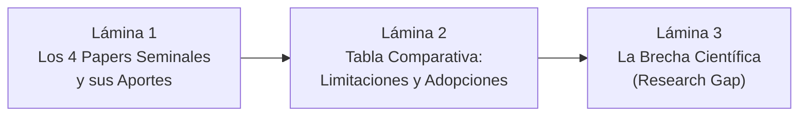

# Guía de Exposición: Sección de Trabajos Relacionados y Literatura Científica
**Curso:** Inteligencia Artificial (1INF24) — Tarea Académica  
**Proyecto:** Clasificación de la Pobreza Monetaria en Lima Metropolitana mediante Aprendizaje Supervisado sobre Microdatos de la ENAHO  
**Autores:** Gael Sebastian Arias Escalante, Melanie Nadine Mallqui Huaraz, Valeshka del Pilar Lavado Guerra, Edilvan Franco Salcedo Enciso  

---

## 📌 1. Objetivos y Dinámica de la Exposición

La defensa de la sección de **Trabajos Relacionados** tiene una duración sugerida de **3 a 4 minutos**. En la rúbrica oficial, esta sección evalúa si el grupo analizó al menos 3 publicaciones científicas relevantes, identificó sus limitaciones y extrajo adaptaciones algorítmicas concretas para el proyecto.

Debe responder con claridad:
1. **¿Qué ha hecho la literatura internacional previa?** (Presentar los 4 papers clave).
2. **¿Cuáles son las limitaciones de esos estudios?** (Sesgo rural, particiones aleatorias sin diseño muestral, falta de evaluación temporal con ML).
3. **¿Cuál es la brecha de investigación (*Research Gap*) que aborda nuestro trabajo?**
4. **¿Qué adaptaciones algorítmicas adoptamos de cada autor?**

---

## 🎞️ 2. Estructura Lámina por Lámina (Slide-by-Slide)

---

### 🔹 LÁMINA 1: Revisión de la Literatura Científica Internacional
* **Tiempo sugerido:** 60 - 75 segundos
* **Título de la diapositiva:** Estado del Arte: Focalización de Pobreza y Aprendizaje Automático
* **Elementos visuales a incluir:**
  * Tarjetas visuales de los **4 papers seminales**:
    1. **McBride & Nichols (2018):** USAID (Bolivia, Timor-Leste, Malawi). Validación cruzada vs. Random Forest y Quantile Regression Forest.
    2. **Brown, Ravallion & van de Walle (2018):** Banco Mundial (9 países africanos). Demostraron que el PMT tradicional por MCO excluye hasta al 81% de los pobres.
    3. **Noriega-Campero et al. (2020):** MIT Media Lab (2 países de América Latina). Demostraron que el ML puede cubrir a casi 1 millón de pobres más sin aumentar el gasto público, pero advierten disparidades éticas por subgrupos.
    4. **Aiken, Ohlenburg & Blumenstock (2023):** UC Berkeley / Banco Mundial (10 años en África). Cuantificaron la obsolescencia: un PMT pierde 1.7 puntos porcentuales de precisión por año si no se recalibra.

#### 🗣️ Guión Verbal (Talking Points):
> *"Para fundamentar nuestro marco metodológico, realizamos una revisión exhaustiva de la literatura científica internacional, analizando cuatro publicaciones seminales en la intersección entre economía del desarrollo y machine learning:*
> 
> * *Primero, **McBride y Nichols (2018)** evaluaron las herramientas de focalización de USAID en Bolivia, Timor-Leste y Malawi. Compararon modelos lineales contra Random Forest y demostraron que un modelo lineal bien regularizado por validación cruzada puede competir de cerca con ensambles complejos.*
> * *Segundo, el estudio clásico de **Brown, Ravallion y van de Walle (2018)** del Banco Mundial evaluó el Proxy Means Testing en nueve países africanos, revelando una cifra alarmante: con una tasa de pobreza del 20%, el método econométrico tradicional llega a excluir al 81% de las familias pobres.*
> * *Tercero, **Noriega-Campero et al. (2020)** demostraron en América Latina que sustituir métodos tradicionales por algoritmos de Machine Learning permitiría cubrir a casi un millón de pobres adicionales con exactamente el mismo presupuesto del Estado, aunque señalaron que la IA puede inducir sesgos involuntarios entre subgrupos demográficos.*
> * *Y cuarto, **Aiken et al. (2023)** analizaron una década de encuestas para medir la degradación temporal, encontrando que un PMT pierde 1.7 puntos de precisión al año si no se actualiza frente a cambios económicos."*

---

### 🔹 LÁMINA 2: Tabla Comparativa: De la Literatura a Nuestro Proyecto
* **Tiempo sugerido:** 60 - 75 segundos
* **Título de la diapositiva:** Matriz de Adopciones y Adaptaciones Algorítmicas
* **Elementos visuales a incluir:**
  * La **Tabla 1** del informe LaTeX resumida en pantalla:

| Paper / Autor | Datos y Contexto | Limitación Detectada | Nuestra Decisión Metodológica |
| :--- | :--- | :--- | :--- |
| **McBride & Nichols (2018)** | Bolivia, Timor, Malawi (1.8k–11k) | Partición aleatoria ignoró el diseño muestral complejo. | Adoptamos validación cruzada rigurosa y un comparador lineal fuerte (ElasticNet). |
| **Brown et al. (2018)** | 9 países de África | Contexto mayormente rural; no exploraron Machine Learning. | Adoptamos el PMT sobre $\ln(\text{gasto})$ como baseline y la prioridad del error de exclusión. |
| **Noriega-Campero et al. (2020)** | 2 países de América Latina | Disparidades no auditadas a nivel explicable local. | Adoptamos la comparación a **igual cobertura presupuestal** y auditoría con **TreeSHAP**. |
| **Aiken et al. (2023)** | 4 países de África (10 años) | Solo evaluaron modelos lineales simples en zonas no urbanas. | Adoptamos la **evaluación fuera de tiempo estricta** (2024 $\to$ 2025). |

#### 🗣️ Guión Verbal (Talking Points):
> *"Como observamos en esta matriz comparativa, no nos limitamos a citar la literatura: identificamos las limitaciones metodológicas de cada estudio previo y las resolvimos en nuestro diseño:*
> 
> * *De **McBride y Nichols** tomamos la exigencia de contar con un baseline lineal altamente optimizado, pero corregimos su limitación: mientras ellos hicieron particiones aleatorias que violan el diseño muestral, nosotros agrupamos por conglomerado censal.*
> * *De **Brown et al.** adoptamos la métrica del Error de Exclusión como el criterio ético prioritario y definimos el PMT econométrico sobre el logaritmo del gasto como nuestra línea base.*
> * *De **Noriega-Campero et al.** incorporamos la política de evaluación a **cobertura presupuestal fija ($B=20\%$)**, que aísla la calidad algorítmica de la capacidad fiscal del Estado.*
> * *Y de **Aiken et al.** tomamos la metodología de prueba **fuera de tiempo**, entrenando con 2024 y evaluando a ciegas en 2025."*

---

### 🔹 LÁMINA 3: La Brecha de Investigación (Research Gap)
* **Tiempo sugerido:** 45 - 60 segundos
* **Título de la diapositiva:** Brecha Científica: ¿Qué vacío llena este trabajo?
* **Elementos visuales a incluir:**
  * Tres pilares del vacío en la literatura:
    1. **Sesgo Rural y Africano:** Casi toda la literatura de PMT con IA proviene de África rural; casi nula evidencia en metrópolis latinoamericanas densas y consolidadas.
    2. **Falta de Validación Conjunta:** Los estudios anteriores no integran simultáneamente el desbalance de clases severo, la comparación presupuestal fija y la prueba fuera de tiempo sin hogares repetidos.
    3. **Contexto Post-Pandemia en Lima:** Ausencia de modelos supervisados modernos auditables entrenados con la ENAHO post-pandemia en Lima Metropolitana (`DOMINIO 8`).
  * Conclusión: **"Este proyecto aporta el primer benchmark riguroso de IA para focalización urbana en Lima con microdatos públicos abiertos"**.

#### 🗣️ Guión Verbal (Talking Points):
> *"Esto nos conduce a la **Brecha de Investigación** que nuestro proyecto resuelve:*
> 
> *La gran mayoría de estudios internacionales de focalización con IA fueron desarrollados para ámbitos rurales en África, donde la falta de activos básicos hace que clasificar la pobreza sea un problema más predecible.*
> 
> *En una megaciudad densa y autoconstruida como Lima Metropolitana, la pobreza urbana post-pandemia no se había estudiado sistemáticamente combinando: (1) clasificación sensible al costo para lidiar con el desbalance de clases, (2) evaluación a igual restricción presupuestal, y (3) blindaje temporal fuera de tiempo con exclusión de panel.*
> 
> *Ese es precisamente el aporte diferencial de nuestra investigación."*

---

## 🎯 3. Conceptos Clave para Defender en Trabajos Relacionados

1. **BPAC (Balanced Poverty Accuracy Criterion):** Criterio utilizado por USAID y McBride para balancear exactitud y cobertura.
2. **Falla Masiva del PMT Clásico:** Brown et al. demostraron que el PMT tradicional deja fuera al 81% de los pobres a un 20% de prevalencia.
3. **Equidad Algorítmica (Fairness):** Noriega-Campero demostró que el ML puede discriminar subgrupos si no se audita conscientemente.
4. **Deriva Temporal (Temporal Drift):** Pérdida de 1.7 p.p. al año documentada por Aiken et al., que justifica evaluar con años separados (2024 a 2025).
5. **Alineamiento con la Rúbrica PUCP:** Se revisan **4 papers** de alto impacto (Scopus/Web of Science/NBER), superando el mínimo requerido de 3.

---

## 🛡️ 4. Preguntas Frecuentes del Jurado sobre Trabajos Relacionados

### P1: *"¿Por qué eligieron estos 4 papers y no artículos locales peruanos?"*
* **Respuesta Experta:**  
  *"Revisamos los antecedentes del MEF y del SISFOH en Perú; sin embargo, los documentos estatales locales utilizan econometría tradicional (regresiones MCO) y no abordan el modelado supervisado con técnicas de Machine Learning ni la auditoría con valores Shapley. Seleccionamos estos cuatro artículos porque representan los hitos metodológicos internacionales más reconocidos que contrastan explícitamente econometría clásica versus algoritmos de IA en sistemas reales de focalización social."*

### P2: *"Si McBride y Nichols demostraron que un modelo lineal regularizado puede rendir casi igual que Random Forest, ¿por qué insistir en probar ensambles y boosting?"*
* **Respuesta Experta:**  
  *"Esa es precisamente nuestra Hipótesis 2 (H2). Queremos contrastar si en el contexto urbano complejo de Lima Metropolitana, donde existen interacciones no lineales entre hacinamiento, informalidad y educación que los modelos lineales no capturan de forma nativa, los ensambles logran o no una ventaja estadísticamente significativa. Al incluir la regresión logística ElasticNet y el baseline PMT-MCO, testeamos con rigor científico si la complejidad algorítmica se justifica."*

---

## ⏱️ 5. Resumen de Tiempos

| Lámina | Contenido Principal | Tiempo | Enfoque |
| :---: | :--- | :---: | :--- |
| **L1** | Los 4 Papers Seminales | 1:15 | Dominio de la literatura científica internacional. |
| **L2** | Matriz de Adopciones y Limitaciones | 1:10 | Conexión directa entre la literatura y nuestro diseño. |
| **L3** | Brecha de Investigación (*Research Gap*) | 0:50 | Justificación de la novedad y pertinencia en Lima. |
| **Total** | **Sección Trabajos Relacionados** | **~3:15** | **Sustento académico sólido y fundamentado.** |
