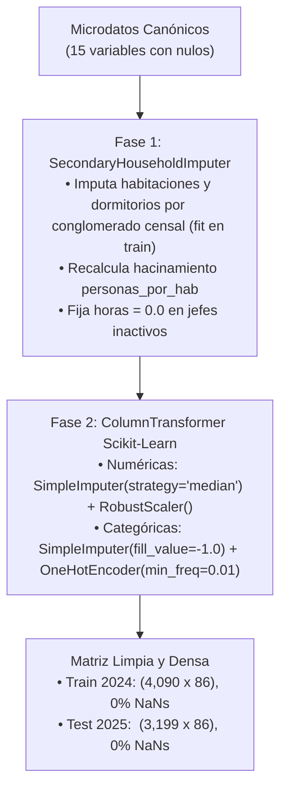

# Log de cambios: 2026-11-11 22:45 (-05:00)

**Autor:** Gael Sebastian Arias Escalante (Equipo 3), con asistencia de Antigravity.  
**Rama:** `reingenieria-codigo`  
**Objeto:** Protocolo Integral de Limpieza de Datos (Data Cleaning & Imputation Protocol) sobre las 15 variables con valores faltantes del espacio canónico $\mathbf{x}_i \in \mathbb{R}^{28}$, política de no eliminación de filas (*Zero Drop-Row Policy*) y validación de preprocesamiento anti-fuga.  
**Equipo 3:**
- 20231149 Arias Escalante, Gael Sebastian.
- 20232374 Mallqui Huaraz, Melanie Nadine.
- 20210761 Lavado Guerra, Valeshka del Pilar.
- 20203178 Salcedo Enciso, Edilvan Franco.

**Estado:** 🔄 **En Ejecución** (Log previo obligatorio antes de formalizar la ejecución en el notebook maestro).

---

## 1. Justificación y Política de Cero Eliminación de Filas (*Zero Drop-Row Policy*)

El análisis exploratorio de datos (EDA) confirmó que exactamente **15 de las 28 variables canónicas** presentan valores faltantes en algún grado en ENAHO 2024 (train) y 2025 (test OOT).

### ¿Por qué está terminantemente prohibido descartar filas (`dropna`)?
1. **Sesgo de Selección en Pobreza:** En los 72 hogares secundarios de 2024 que carecen de registro físico en Módulo 01, la tasa de pobreza real es del **27.78%** (frente al 18.92% de la muestra general). Eliminar estos hogares eliminaría desproporcionadamente a familias hacinadas e inquilinos vulnerables.
2. **Sesgo en Servicios Básicos:** En los 225 hogares con nulo en `agua_todos_los_dias`, la pobreza es del **39.53%** (porque no tienen conexión continua de red pública). Eliminar estos casos distorsionaría la frontera de decisión.
3. **Pérdida de Representatividad Muestral:** Reducir la muestra violaría el diseño muestral bietápico probabilístico del INEI y alteraría los factores de expansión poblacional.
4. **Criterio Metodológico:** El 100% de los 4,090 hogares de 2024 y 3,199 hogares independientes de 2025 deben ser preservados íntegramente mediante imputación robusta y controlada.

---

## 2. Taxonomía de Nulos y Estrategia de Imputación por Variable

| N° | Variable | Tipo | Nulos 2024 | Nulos 2025 | Origen Metodológico (INEI) | Estrategia de Imputación Aplicada |
| :---: | :--- | :---: | :---: | :---: | :--- | :--- |
| 1 | `total_habitaciones` | Numérica | 72 | 91 | Hogar secundario (`hogar >= '22'`) | **Mediana del conglomerado censal** (`CONGLOME`) del pliegue de train, con *fallback* a la mediana global de train. |
| 2 | `total_dormitorios` | Numérica | 72 | 91 | Hogar secundario (`hogar >= '22'`) | **Mediana del conglomerado censal** (`CONGLOME`) del pliegue de train, con *fallback* a la mediana global de train. |
| 3 | `personas_por_hab` | Numérica | 72 | 91 | Ratio derivado con `total_habitaciones` | **Recálculo consistente:** $\text{miembros} / \text{habitaciones}$ inmediatamente después de la imputación física. |
| 4 | `tipo_vivienda` | Categórica | 72 | 91 | Hogar secundario (`hogar >= '22'`) | Categoría sentinela `-1.0` (**"desconocido"**). |
| 5 | `material_pared` | Categórica | 72 | 91 | Hogar secundario (`hogar >= '22'`) | Categoría sentinela `-1.0` (**"desconocido"**). |
| 6 | `material_piso` | Categórica | 72 | 91 | Hogar secundario (`hogar >= '22'`) | Categoría sentinela `-1.0` (**"desconocido"**). |
| 7 | `agua_todos_los_dias` | Categórica | 225 | 195 | Solo se pregunta si tiene red pública (`P110 in {1, 2}`). Si usan cisterna o pilón, queda vacío. | Nulo estructural: Categoría sentinela `-1.0` (**"sin_red_publica_continua"**). |
| 8 | `combustible_cocina` | Categórica | 46 | 44 | Hogares que no cocinan o usan fuentes atípicas. | Categoría sentinela `-1.0` (**"no_cocina / desconocido"**). |
| 9 | `jefe_edad` | Numérica | 25 | 37 | Hogar sin miembro `P203 == 1` (jefe ausente o no encuestado). | **Mediana de entrenamiento** (54.0 años). |
| 10 | `educ_jefe` | Numérica | 27 | 39 | 25 por jefe ausente + 2 sin nivel reportado. | **Mediana de entrenamiento** (6.0 = Secundaria completa). |
| 11 | `jefe_horas_semanales` | Numérica | 25 | 37 | Jefes ausentes (los 1,232 inactivos ya se fijaron en 0.0). | **Mediana de entrenamiento** (44.0 horas) dentro de los que trabajan. |
| 12 | `jefe_ocupado` | Categórica | 25 | 37 | Jefes ausentes sin registro de actividad. | Categoría sentinela `-1.0` (**"desconocido"**). |
| 13 | `jefe_cat_ocupacional` | Categórica | 25 | 37 | Jefes ausentes (los inactivos ya son 0.0 "no aplica"). | Categoría sentinela `-1.0` (**"desconocido"**). |
| 14 | `jefe_empresa_ruc` | Categórica | 25 | 37 | Jefes ausentes (los inactivos ya son 0.0 "no aplica"). | Categoría sentinela `-1.0` (**"desconocido"**). |
| 15 | `jefe_sin_pension` | Categórica | 48 | 45 | 25 por jefe ausente + 23 sin respuesta previsional. | Categoría sentinela `-1.0` (**"desconocido"**). |

*Las 13 variables restantes (`n_miembros`, `n_ninos_0_5`, `n_menores_14`, `n_mayores_65`, `tasa_dependencia`, `jefe_mujer`, `educ_max_hogar`, `n_ocupados`, `ocupados_por_miembro`, `tenencia_vivienda`, `fuente_agua`, `conexion_bano`, `tiene_internet`) presentan **0 nulos**.*

---

## 3. Arquitectura del Pipeline de Limpieza en Dos Fases

Para garantizar **cero fuga de datos** y compatibilidad con `GroupKFold`, la limpieza opera en dos capas secuenciales:

---

## 4. Plan de Acción Inmediato
1. [x] Creación del presente log `log_cambios_2026-11-11_22-45.md`.
2. [ ] Actualizar el índice maestro en `Documentation/Observaciones a levantar/README.md`.
3. [ ] Añadir en `notebooks/pipeline_completo.ipynb` una sección visual explícita de "Data Cleaning y Verificación de Nulos Cero" que muestre el antes y después de cada variable.
4. [ ] Proceder a la creación de `src/models.py` (Sprint 6).
