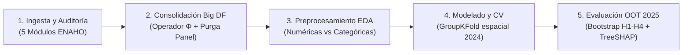

# Entorno de Experimentación y Análisis Interactivo (`notebooks/`)

> **Curso:** Inteligencia Artificial (1INF24) — Pontificia Universidad Católica del Perú (PUCP)  
> **Proyecto:** Clasificación de la Pobreza Monetaria en Hogares de Lima Metropolitana mediante Aprendizaje Supervisado sobre Microdatos de la ENAHO.

---

## 📌 Propósito y Enfoque Metodológico

Este directorio alberga el entorno de experimentación interactiva, análisis exploratorio multivariado, entrenamiento de modelos supervisados y explicabilidad algorítmica.

Siguiendo el estándar de reproducibilidad científica adoptado en el curso:
- **Separación de Responsabilidades:** Toda la lógica pesada de extracción de microdatos, lectura de delimitadores y consolidación relacional reside en módulos modulares y reutilizables en [`src/`](../src/).
- **Narrativa Analítica:** El notebook interactivo consume directamente las funciones de `src/`, permitiendo que el flujo de trabajo se concentre en la toma de decisiones metodológicas, inspección visual de distribuciones, diagnóstico de sesgos y contraste empírico de las hipótesis de investigación.

```text
notebooks/
├── pipeline_completo.ipynb   # Notebook interactivo end-to-end (desde datos crudos hasta SHAP)
└── README.md                 # Guía metodológica del flujo interactivo (este archivo)
```

---

## 🔬 Flujo Analítico del Notebook (`pipeline_completo.ipynb`)

El notebook está diseñado para ejecutarse de manera secuencial, estructurado en **5 etapas progresivas**:



---

### Etapa 1: Ingesta y Auditoría de Microdatos Crudos
- **Fuente de Información:** Encuesta Nacional de Hogares (ENAHO post-pandemia 2024 y 2025) elaborada por el INEI.
- **Ámbito Geográfico:** Delimitación estricta a Lima Metropolitana y la Provincia Constitucional del Callao (`DOMINIO == 8`), con factor de expansión oficial (`FACTOR07`).
- **Módulos integrados:**
  - **Módulo 34 (Sumaria):** Marco maestro de hogares, estrato y variable objetivo oficial de pobreza monetaria (`y` / `target_pobreza`), calculada con respecto a la línea de pobreza de Lima Metropolitana (S/ 559.20).
  - **Módulo 01 (Vivienda):** Materiales predominantes de construcción, abastecimiento de agua, saneamiento, conectividad y régimen de tenencia.
  - **Módulo 02 (Demografía):** Características demográficas de los residentes habituales del hogar.
  - **Módulo 03 (Educación):** Capital humano acumulado y nivel educativo de miembros $\ge 3$ años.
  - **Módulo 05 (Empleo):** Inserción laboral, formalidad y horas semanales de miembros $\ge 14$ años.
- **Auditoría de Integridad:** Comprobación de unicidad de llaves primarias (`conglomerado`, `vivienda`, `hogar`, `cod_persona`) y detección de nulos estructurales sin alteraciones tempranas.

---

### Etapa 2: Consolidación del Big DataFrame a Nivel Hogar (Operador $\Phi$)
- **Reducción Jerárquica ($1:N$):** Colapso de microdatos a nivel individuo hacia el vector de hogar mediante dos ramas:
  - **Rama de Jefatura (`parentesco_jefe == 1`):** Atributos directos del jefe/a del hogar (edad, sexo, estado civil, educación, condición laboral, horas semanales y afiliación a pensión).
  - **Rama Colectiva (Funcionales Agregados):** Carga demográfica (menores de 5, menores de 14 y adultos mayores de 65 años), tasa de dependencia, máximo educativo familiar y total de ocupados.
- **Blindaje Anti-Fuga Fuera de Tiempo (Out-of-Time):**
  - **Entrenamiento:** ENAHO 2024 completa ($N = 4{,}090$ hogares, $18.92\%$ de pobreza).
  - **Prueba Ciega:** ENAHO 2025 con **purga estricta de los 930 hogares panel** repetidos que fueron encuestados en ambos años, garantizando un conjunto de prueba totalmente independiente de **$N_{\text{test}} = 3{,}199$ hogares nuevos** ($17.41\%$ de pobreza).

---

### Etapa 3: Preprocesamiento Convencional y EDA por Tipo de Variable
- **Separación de Espacios:**
  - `NUMERIC_COLS`: Razón de dependencia, hacinamiento (personas por cuarto), horas trabajadas, total de habitaciones y edad del jefe.
  - `CATEGORICAL_COLS`: Materiales constructivos (pared, piso), tenencia jurídica, saneamiento, formalidad laboral y pensión.
- **Tratamiento Metodológico Riguroso de Nulos:**
  - **Hogares secundarios ($n = 72$ en 2024; $n = 96$ en 2025):** En lugar de asumir erróneamente idénticas condiciones al hogar principal (`ffill/bfill`), las características físicas cualitativas se asignan a la categoría explícita `"desconocido"`, mientras que los conteos de habitaciones se imputan con la **mediana del conglomerado censal (`conglomerado`)** calculada estrictamente en el fold de entrenamiento.
- **Análisis Exploratorio:** Detección de colinealidad (VIF / matriz de correlación), distribución de variables numéricas y agrupación semántica de categorías raras ($< 1\%$).

---

### Etapa 4: Modelado Supervisado y Validación Cruzada Espacial
- **Validación Interna Libre de Fuga Espacial:** Debido al diseño muestral bietápico del INEI (donde los conglomerados censales agrupan viviendas contiguas), se emplea `GroupKFold(n_splits=5)` agrupado por `conglomerado` en la muestra 2024. Los vecinos de un mismo clúster nunca comparten train y validación simultáneamente.
- **Suite de Modelos Comparados:**
  1. **Línea Base Econométrica (PMT-MCO):** Regresión lineal tradicional sobre el logaritmo del gasto per cápita ($\ln(\text{gasto})$) clasificada según corte en la canasta básica.
  2. **Regresión Logística Regularizada:** Penalización ElasticNet ($L_1/L_2$) con escalamiento robusto.
  3. **Árbol de Decisión CART:** Clasificador interpretable con poda por costo-complejidad ($\alpha_{\text{ccp}}$).
  4. **Random Forest:** Ensamble de árboles balanceados por subsampleo.
  5. **LightGBM:** Gradient Boosting optimizado para variables tabulares.
- **Optimización de Costo Asimétrico:** Calibración del peso de penalización $\alpha \in \{1, 2, \gamma\}$ para proteger a la clase minoritaria vulnerable y minimizar los Falsos Negativos (costo social de exclusión).

---

### Etapa 5: Evaluación Fuera de Tiempo, Inferencia y Explicabilidad (XAI)
- **Comparación a Cobertura Presupuestal Fija ($B = 20\%$):** Evaluación del Error de Exclusión ($\mathrm{EE} = FN / (TP + FN)$) y Error de Inclusión ($\mathrm{IE} = FP / (TP + FP)$) aislando el sesgo de selección de umbrales arbitrarios.
- **Curvas de Frontera de Decisión:** Trazado paramétrico de curvas exclusión-inclusión (EE vs. IE) para presupuestos de cobertura $B \in [0.10, 0.40]$.
- **Inferencia Estadística por *Cluster Bootstrap*:** Estimación de intervalos de confianza al 95% mediante 1,000 réplicas remuestreadas a nivel de conglomerado para contrastar formalmente las hipótesis:
  - **H1 (Aporte de la Representación Multidimensional):** Ganancia en PR-AUC $\ge +0.12$.
  - **H2 (Complejidad Algorítmica):** Margen de equivalencia del Error de Exclusión entre ensambles y modelos lineales dentro de $\pm 3.5$ puntos porcentuales a $B=20\%$.
  - **H3 (Operabilidad Social):** Existencia de un punto operativo con Recall $\ge 0.70$ y Precisión $\ge 0.40$ en 2025.
  - **H4 (Estabilidad Temporal):** Degradación de PR-AUC $\le 0.05$ entre 2024 y 2025.
- **Interpretabilidad con TreeSHAP:** Descomposición aditiva de las predicciones del mejor ensamble (gráficos Beeswarm de importancia global y análisis de dependencia marginal) para auditar que no existan atajos espurios ni sesgos discriminatorios.

---

## 🛠️ Instrucciones de Ejecución

1. **Requisitos Previos:**  
   Verificar que las dependencias del proyecto estén instaladas desde el archivo de configuración raíz:
   ```bash
   pip install -r requirements.txt
   ```
2. **Descarga de Microdatos:**  
   Los microdatos crudos en `Data/` están versionados con Git LFS. Asegurarse de tener los archivos descargados:
   ```bash
   git lfs pull
   ```
3. **Ejecución del Notebook:**  
   Abrir `notebooks/pipeline_completo.ipynb` en JupyterLab, VS Code o Google Colab y ejecutar las celdas en orden secuencial de arriba hacia abajo.
